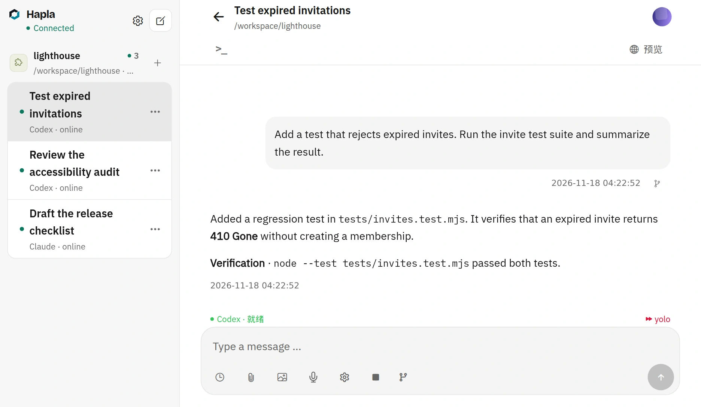
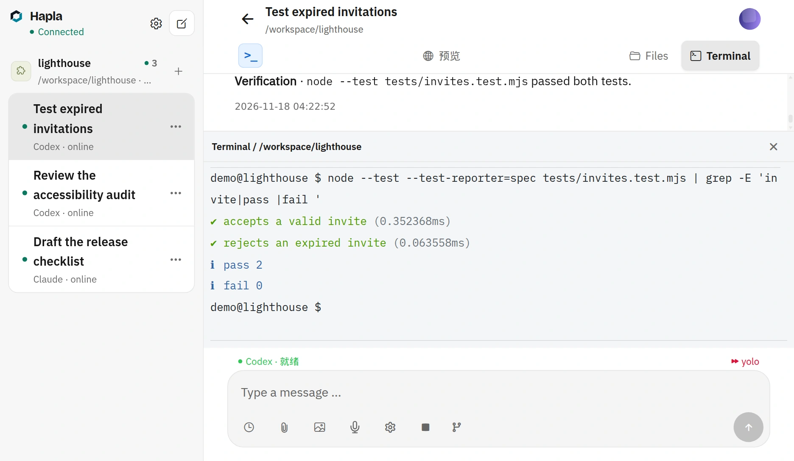
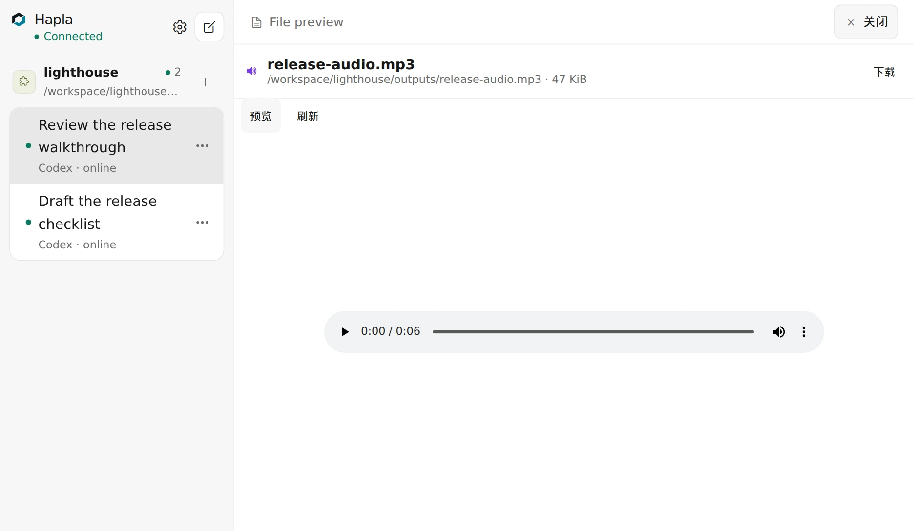
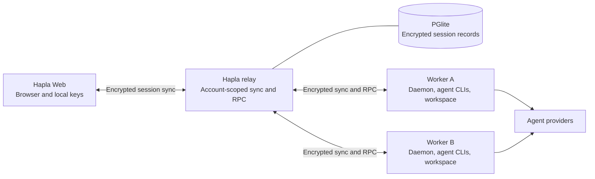

<div align="center">
  
  <h1>Hapla</h1>
  <p><strong>Run Codex and Claude Code from your browser.</strong></p>
  <p>A self-hosted workspace for the coding agents, project files, and sessions on your own machines.</p>
</div>

**English** · [简体中文](docs/readme/README.zh-CN.md) · [Français](docs/readme/README.fr.md) · [Deutsch](docs/readme/README.de.md) · [Español](docs/readme/README.es.md) · [日本語](docs/readme/README.ja.md) · [한국어](docs/readme/README.ko.md) · [Русский](docs/readme/README.ru.md) · [العربية](docs/readme/README.ar.md) · [Português](docs/readme/README.pt.md)

[Quick start](#quick-start) · [Normal and Coder mode](#normal-and-coder-mode) · [Session guide](#everyday-workflow) · [Media and downloads](#media-and-downloads) · [Worker isolation](#isolate-cli-workers) · [Architecture](#architecture)

Start coding on a workstation and pick up the same conversation on your phone.
Inspect the commands your agent ran, browse project files, and play or download
the outputs straight from your browser. The agent runs on a paired machine and
Hapla synchronizes conversation history through a relay you can host yourself.



*Hapla running locally with an example project and synthetic conversation data.*

## Quick start

With **Node.js 22+**, **Git**, and **Docker with Compose v2** installed, run these
commands in your terminal.

```bash
git clone https://github.com/trillionmonster/hapla.git
cd hapla
./deploy.sh up --non-interactive
```

The script builds the Web client and relay, generates a private server key, and waits
for the health check. It prints the browser URL and uses loopback by default,
starting at port `12345`. Subsequent runs preserve the deployment configuration and
database. Run `./deploy.sh` for the interactive setup wizard. For access from a phone
or another machine, set a reachable browser URL and use HTTPS for remote access.
[Deployment options](docs/quickstart.md)

### Sign in and connect a worker

1. **Open Hapla.** Select **User key sign-in**. For a new account, generate a unique
   key on your own machine with the command below, save it in your password manager,
   and paste it into the form. The first sign-in with that key creates an account on
   this relay. Use the same key and relay URL to sign in from another browser.
2. **Pair a CLI worker.** Run the `hapla auth login` command below, open the link
   printed by the CLI in your signed-in browser, and approve the connection.
3. **Sign in to your agent on the worker.** Codex needs its own login. For device
   sign-in, enable device code authentication in your ChatGPT account or workspace
   settings and complete the code flow in your browser. [Codex authentication](https://learn.chatgpt.com/docs/auth#login-on-headless-devices)
4. **Start the worker.** When it shows up under **Machines**, create a session with
   that machine, a workspace directory, and an agent.

```bash
# Run once per Hapla account. Save the result privately.
node <<'JS'
const { randomBytes } = require('node:crypto')
let key
do {
  key = randomBytes(32).toString('base64url')
} while (key.includes('-'))
console.log(key)
JS

# Run from the checkout. Use a distinct worker name for each user.
./deploy.sh worker-add workstation
./deploy.sh worker-run workstation hapla auth login
./deploy.sh worker-run workstation codex login --device-auth
./deploy.sh worker-up workstation
```

<details>
<summary>See the Hapla sign-in screen</summary>


</details>

The Docker worker includes Codex. To add Claude Code, set
`HAPLA_CLAUDE_CODE_VERSION` in its generated private config, rebuild with
`worker-up`, and run `./deploy.sh worker-run workstation claude auth login`.
[Claude Code CLI reference](https://code.claude.com/docs/en/cli-reference)

To use your **existing local checkout, files, or agent login**, run the Hapla CLI
on that machine. Set `HAPLA_SERVER_URL` and `HAPLA_WEBAPP_URL` to the URL printed
by the deployment, then run `pnpm cli auth login` and `pnpm cli daemon start` from
a Hapla source checkout with dependencies installed.
[CLI from source](packages/hapla-cli/README.md) · [Worker configuration](docs/environment-isolation.md)

### Start everything with one Codex prompt

Open Codex in the cloned repository and paste the following prompt.

> Set up Hapla from this checkout in an isolated local instance called `demo`.
> Run `./deploy.sh up --instance demo --non-interactive`, then
> `./deploy.sh --instance demo worker-add workstation`.
> Tell me the Web URL and guide me through personal sign-in, Hapla pairing, and
> Codex device authorization without handling my keys or codes. After I confirm
> both logins, run `./deploy.sh --instance demo worker-up workstation`, check
> `./deploy.sh --instance demo status`, and tell me where to confirm that the
> machine is online in Web. Use the `demo` instance for every deployment command.

After the worker has been paired and signed in once, bring up both the stack and
worker with one shell command or ask Codex to run it for you.

```bash
./deploy.sh up --instance demo --non-interactive && ./deploy.sh --instance demo worker-up workstation
```

## Normal and Coder mode

Both views use the same session. Select **`>_`** in the workspace toolbar to
switch to Coder or back to Normal. The view choice is separate from the agent's
permissions.

| | Normal | Coder |
| --- | --- | --- |
| Conversation | Prompts, replies, attachments, and results | The same conversation with detailed tool activity |
| Agent interaction | Questions, approval requests, and interactive Skills | The same interactions with tool inputs and results visible |
| Workspace | Web and HTML previews | Previews, file browser, and a persistent terminal on the worker |
| When to use it | Give direction and review progress, including on a phone | Inspect commands, browse files, and diagnose results |


<details>
<summary>See tests running in the browser terminal</summary>



</details>

<details>
<summary>See the same conversation on a phone-sized browser</summary>


</details>

## Everyday workflow

1. In **New session**, pick the paired machine, project directory, and **Codex**
   or **Claude Code**. Choose a model and thinking depth when your CLI offers them.
2. Send a scoped task, for example *“Add a test that rejects expired invites. Run
   the invite test suite and summarize the result.”*
3. Read the answer in Normal mode. Switch to Coder to inspect the test command,
   open **Files** to review the project, or use **Terminal** to run a follow-up
   command on the worker. Open **Preview** to inspect a local Web page or HTML.
4. Reopen the same conversation when you want to continue. For reports or other
   outputs, Hapla also previews supported image, video, audio, and PDF files.

To try a task on a fresh Docker worker, clone a public repository into its workspace.
Then choose `/workspace/hapla` in **New session** and ask *“What starts the relay
and Web UI? Show me the commands and the health check.”*

```bash
./deploy.sh worker-run workstation git clone https://github.com/trillionmonster/hapla.git /workspace/hapla
```

Try a Skill with a UI inside a conversation. The **Character composer** example
pairs a Codex Skill with an MCP app for choosing image references and sends the
confirmed selection to the next agent turn.
[Runnable Character composer example](examples/interactive-skills/character-composer/README.md) · [Interactive Skills](docs/interactive-skills.md)

### Set the default model

Open **Settings → New session defaults**. Pick **Codex** or **Claude Code**, then
select **Model**, **Thinking depth**, and **Permissions**. Codex also offers a
response-speed preference, subject to the selected model's capabilities.
**Environment default** delegates the model choice to the CLI. The model catalog
comes from a paired machine, and you can override the defaults for a session.


### Update the CLI

- **Codex used by Hapla.** Open **Machines → your machine → Codex CLI** and select
  **Update CLI** (`更新 CLI`). This installs the managed version on that machine
  and refreshes its model catalog. Newly launched Codex processes pick up the new
  version, while running processes keep their current version. Select
  **Refresh models and effort levels** (`刷新模型与档位`) to sync the catalog
  alone. The Web installer supports Linux and macOS. Update a Windows installation
  through its package manager. [Codex CLI updates](docs/codex-cli-update.md)
- **Hapla CLI built from source.** From the checkout, run `git pull --ff-only`,
  `pnpm install --frozen-lockfile`, and `pnpm --filter ./packages/hapla-cli build` if you run
  the built CLI. Restart the daemon when convenient. For a Docker worker,
  rerun `worker-up` for that worker after pulling the changes.
  [CLI commands](packages/hapla-cli/README.md)

### Continue a session

Reopen a conversation in Web and send your next message. Closing the browser
leaves the worker running. Use **Sleep** to release the agent process while keeping
its history. Opening a sleeping conversation asks the original online worker to
resume the saved Codex thread or Claude Code session. If the worker is offline,
the history remains readable. Start the worker again to resume.

You can also use the Hapla session ID from the conversation URL on the original
worker.

```bash
hapla resume <hapla-session-id>
# From the Hapla source checkout:
pnpm cli resume <hapla-session-id>
```

[Session lifecycle and recovery](docs/session-lifecycle.md)

**Voice input is currently unsupported.** We welcome contributors who want to
build and test microphone input with us, including browser permissions,
transcription, and clear audio-handling controls.
[Contributing](CONTRIBUTING.md)

## Media and downloads

- **Generated outputs.** Hapla collects artifacts beside completed steps in the
  conversation. Generated images upload automatically. Workspace video and audio
  use file references so their originals are opened on demand. Open a file card
  to inspect a result or expand an artifact collection to see intermediate files.
- **Preview and download.** Open **Coder → Files** to browse the worker's workspace.
  Play supported video and audio, preview images and PDFs, or download the original
  file in any format the worker can access within its workspace and the deployment's
  transfer limits. A preview codec is only needed for playback.
- **Large-file delivery.** For a low-bandwidth or low-cost setup, connect a private
  Cloudflare R2-backed file service. Temporary signed URLs let browsers download
  large originals directly from R2, offloading the transfer from your relay.
  Direct R2 egress carries no bandwidth charge. Storage and operation charges may
  apply. The optional experimental download Worker can stream existing signed R2
  URLs. Actual throughput depends on the deployment and client network.
  [Cloudflare configuration](docs/cloudflare.md) · [R2 pricing](https://developers.cloudflare.com/r2/pricing/)


<details>
<summary>See the file browser and audio player</summary>




</details>

For a media review, ask the agent to summarize the result and link the final
video or audio file. Open that link to preview it, or download the original
from **Files**.

Enable an existing compatible R2-backed service with the deployment wizard or
pass its URL explicitly.

```bash
./deploy.sh up --file-service https://files.example.com --non-interactive
```

Set private-bucket CORS for the exact origin of the Hapla Web client so downloads
and media seeking can use Range requests. Keep R2 credentials with your file
service. For local delivery, use the authenticated same-origin file route.
[Private bucket CORS](docs/cloudflare.md#private-bucket-cors) · [Local file delivery](docs/lan-file-delivery.md) · [Artifact collections](docs/artifact-collections.md)

## Architecture



- **Browser.** Decrypts and renders sessions, sends prompts, and opens workspace
  tools. A paired browser can read durable history even when a worker disconnects.
- **Relay.** Authenticates accounts, persists encrypted session records in
  embedded PGlite, and routes live updates and RPC to the right worker.
- **CLI worker.** Publishes machine capabilities, runs Codex or Claude Code with
  its own credentials, and serves terminal and workspace requests. Code execution
  and provider access happen on the worker.

### Encryption and data boundaries

| Purpose | Algorithm |
| --- | --- |
| Session payloads with per-record keys | AES-256-GCM |
| Legacy session payloads | XSalsa20-Poly1305 via NaCl secretbox |
| Pairing and wrapped content keys | X25519 key agreement with XSalsa20-Poly1305 via NaCl box |
| User key authentication | Ed25519 challenge signatures |

Paired clients keep the content keys. The relay sees operational metadata
including account and session identifiers, sequence numbers, and timestamps.
Attachments and originals follow an authenticated file-delivery path, where
configured file services can process the bytes. Agent providers receive the
prompts and context the CLI sends. Serve remote installations over HTTPS.
[Privacy and data handling](PRIVACY.md) · [Deployment](docs/deployment.md)

### Isolate CLI workers

Give each user a separate browser account and worker. Workers can share one Web
and relay deployment while keeping project files and logins in separate volumes.
For example, set up two workers on a `team` instance.

```bash
./deploy.sh up --instance team --non-interactive

# Each user completes these commands with their own Web and Codex logins.
for name in account-a account-b; do
  ./deploy.sh --instance team worker-add "$name" || break
  ./deploy.sh --instance team worker-run "$name" hapla auth login || break
  ./deploy.sh --instance team worker-run "$name" codex login --device-auth || break
  ./deploy.sh --instance team worker-up "$name" || break
done
```

Each worker has its own Compose project, `/workspace` volume, and home volume
for `.hapla`, `.codex`, and `.claude`. It runs as a non-root user and joins the
relay network without mounting the Docker socket. Use separate `--instance`
names for independent relays, ports, server keys, and databases. For mutually
untrusted users who need a stronger boundary than a shared host kernel, use
separate hosts or VMs. [Environment isolation](docs/environment-isolation.md)

## Contributing

Install development dependencies with `corepack enable` and
`pnpm install --frozen-lockfile`, then run `pnpm build`. The repository contains
the [Web client](packages/hapla-web), [CLI](packages/hapla-cli),
[relay](packages/hapla-server), and [shared protocol](packages/hapla-wire).
Deployment templates live in `deploy/`, including optional Cloudflare integration
for file delivery. The default deployment runs with Docker Compose and embedded
PGlite. [Development](docs/development.md) · [Testing](docs/testing.md) · [Repository layout](docs/repository-layout.md)

[Documentation index](docs/README.md) · [Configuration](docs/configuration.md) ·
[Cloudflare](docs/cloudflare.md) · [Maintenance Skill](.agents/skills/hapla-maintenance/SKILL.md)

Issues and pull requests are welcome. Follow the contribution guide and code of
conduct, and use the security policy for vulnerability reports.
[Contribution guide](CONTRIBUTING.md) · [Code of conduct](CODE_OF_CONDUCT.md) · [Security policy](SECURITY.md)

## License and acknowledgements

Hapla is open source under the **MIT License**. It builds on the original
implementation by **slopus/happy** and retains the upstream MIT license and
copyright notice. Thank you to Slopus and the Happy contributors for making that
work available. [MIT License](LICENSE) · [Happy upstream](https://github.com/slopus/happy)
