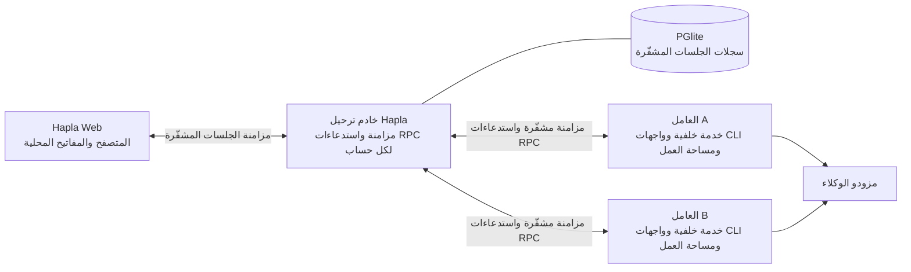

<div align="center" dir="rtl">
  
  <h1>Hapla</h1>
  <p><strong>شغّل Codex وClaude Code من متصفحك.</strong></p>
  <p>مساحة عمل تستضيفها بنفسك لتشغيل وكلاء البرمجة والوصول إلى ملفات مشاريعك وجلساتك على أجهزتك.</p>
</div>

[English](../../README.md) · [简体中文](README.zh-CN.md) · [Français](README.fr.md) · [Deutsch](README.de.md) · [Español](README.es.md) · [日本語](README.ja.md) · [한국어](README.ko.md) · [Русский](README.ru.md) · **العربية** · [Português](README.pt.md)

[البدء السريع](#quick-start) · [وضعا Normal وCoder](#normal-and-coder-mode) · [الاستخدام اليومي](#everyday-workflow) · [الوسائط والتنزيلات](#media-and-downloads) · [عزل العُمّال](#isolate-cli-workers) · [البنية](#architecture)

<div dir="rtl">

ابدأ البرمجة على محطة العمل وتابع المحادثة نفسها على هاتفك. يمكنك من المتصفح مراجعة الأوامر التي نفّذها الوكيل، وتصفح ملفات المشروع، وتشغيل النتائج أو تنزيلها. يعمل الوكيل على جهاز مقترن، ويزامن Hapla سجل المحادثة عبر خادم ترحيل يمكنك استضافته.


*تشغيل محلي لـ Hapla باستخدام مشروع تجريبي وبيانات محادثة اصطناعية.*

<a name="quick-start"></a>

## البدء السريع

ثبّت **Node.js 22+** و**Git** و**Docker مع Compose v2**، ثم نفّذ الأوامر التالية في الطرفية.

```bash
git clone https://github.com/trillionmonster/hapla.git
cd hapla
./deploy.sh up --non-interactive
```

يبني البرنامج النصي عميل الويب وخادم الترحيل، وينشئ مفتاحاً خاصاً بالخادم، وينتظر نجاح فحص الجاهزية. ثم يعرض عنوان URL للمتصفح. الإعداد الافتراضي يستمع على واجهة الاسترجاع المحلي ويبحث عن منفذ متاح ابتداءً من `12345`. تبقى الإعدادات وقاعدة البيانات محفوظة عند إعادة التشغيل. يفتح `./deploy.sh` معالج الإعداد التفاعلي. للوصول من هاتف أو جهاز آخر، اضبط عنوان ويب يمكن الوصول إليه واستخدم HTTPS للاتصال البعيد. [خيارات النشر](../quickstart.md)

### تسجيل الدخول وإقران عامل

1. **افتح Hapla.** اختر **User key sign-in**. لإنشاء حساب، ولّد مفتاحاً فريداً على جهازك بالأمر أدناه، واحفظه في مدير كلمات المرور ثم ألصقه في النموذج. أول تسجيل دخول بالمفتاح ينشئ الحساب على خادم الترحيل هذا. استخدم المفتاح نفسه وعنوان الخادم نفسه عند الدخول من متصفح آخر.
2. **أقرن عامل CLI.** نفّذ `hapla auth login` كما هو موضح أدناه. افتح الرابط الذي يعرضه الأمر في المتصفح المسجّل دخوله ووافق على الاتصال.
3. **سجّل الدخول إلى الوكيل على العامل.** يحتاج Codex إلى مصادقة مستقلة. فعّل المصادقة برمز الجهاز في إعدادات حساب ChatGPT أو مساحة العمل، وأكمل الخطوات في المتصفح. [مصادقة Codex](https://learn.chatgpt.com/docs/auth#login-on-headless-devices)
4. **شغّل العامل.** عند ظهور الجهاز ضمن **Machines**، أنشئ جلسة وحدّد الجهاز ومجلد العمل والوكيل.

```bash
# نفّذ مرة واحدة لكل حساب Hapla واحتفظ بالنتيجة في مكان خاص.
node <<'JS'
const { randomBytes } = require('node:crypto')
let key
do {
  key = randomBytes(32).toString('base64url')
} while (key.includes('-'))
console.log(key)
JS

# نفّذ من المستودع واستخدم اسم عامل مختلفاً لكل مستخدم.
./deploy.sh worker-add workstation
./deploy.sh worker-run workstation hapla auth login
./deploy.sh worker-run workstation codex login --device-auth
./deploy.sh worker-up workstation
```

<details>
<summary>عرض شاشة تسجيل الدخول في Hapla</summary>


</details>

يتضمن عامل Docker برنامج Codex. لإضافة Claude Code، اضبط `HAPLA_CLAUDE_CODE_VERSION` في الإعداد الخاص الذي جرى إنشاؤه للعامل، وأعد البناء باستخدام `worker-up`، ثم نفّذ `./deploy.sh worker-run workstation claude auth login`. [مرجع Claude Code CLI](https://code.claude.com/docs/en/cli-reference)

لاستخدام **مستودع محلي أو ملفات موجودة أو تسجيل دخول سابق إلى الوكيل**، شغّل Hapla CLI على ذلك الجهاز. اضبط `HAPLA_SERVER_URL` و`HAPLA_WEBAPP_URL` على العنوان الذي ظهر بعد النشر. نفّذ `pnpm cli auth login` و`pnpm cli daemon start` من نسخة شيفرة Hapla التي ثبّتت تبعياتها. [تشغيل CLI من الشيفرة المصدرية](../../packages/hapla-cli/README.md) · [إعداد العامل](../environment-isolation.md)

### تشغيل البيئة كلها بطلب واحد إلى Codex

افتح Codex داخل المستودع المستنسخ وألصق الطلب التالي.

> أعدّ Hapla من هذا المستودع في بيئة محلية معزولة باسم `demo`. نفّذ `./deploy.sh up --instance demo --non-interactive` ثم `./deploy.sh --instance demo worker-add workstation`.
> أعطني عنوان الويب وأرشدني إلى تسجيل الدخول وإقران عامل Hapla وتفويض الجهاز في Codex. سأدخل مفاتيحي ورموزي بنفسي.
> بعد أن أؤكد اكتمال عمليتي تسجيل الدخول، نفّذ `./deploy.sh --instance demo worker-up workstation` وتحقق من `./deploy.sh --instance demo status`. أخبرني أين أتحقق في واجهة الويب من أن الجهاز متصل. استخدم البيئة `demo` في جميع أوامر النشر.

بعد إقران العامل وتسجيل الدخول للمرة الأولى، يمكنك تشغيل الخدمات والعامل بأمر واحد أو أن تطلب من Codex تنفيذه.

```bash
./deploy.sh up --instance demo --non-interactive && ./deploy.sh --instance demo worker-up workstation
```

<a name="normal-and-coder-mode"></a>

## وضعا Normal وCoder

يعرض الوضعان الجلسة نفسها. اختر **`>_`** في شريط أدوات مساحة العمل للتبديل بينهما. اختيار العرض مستقل عن صلاحيات الوكيل.

| | Normal | Coder |
| --- | --- | --- |
| المحادثة | الطلبات والردود والمرفقات والنتائج | المحادثة نفسها مع تفاصيل نشاط الأدوات |
| التفاعل مع الوكيل | الأسئلة وطلبات الموافقة والمهارات التفاعلية | التفاعلات نفسها مع عرض مدخلات الأدوات ونتائجها |
| مساحة العمل | معاينة صفحات الويب وHTML | المعاينة ومتصفح الملفات وطرفية مستمرة على العامل |
| متى تستخدمه | توجيه العمل ومراجعة التقدم، بما في ذلك من الهاتف | فحص الأوامر وتصفح الملفات وتشخيص النتائج |


<details>
<summary>عرض الاختبارات في طرفية المتصفح</summary>


</details>

<details>
<summary>عرض المحادثة نفسها بحجم شاشة هاتف</summary>


</details>

<a name="everyday-workflow"></a>

## الاستخدام اليومي

1. في **New session**، اختر الجهاز المقترن ومجلد المشروع و**Codex** أو **Claude Code**. اختر النموذج وعمق التفكير إن أتاحتهما واجهة CLI.
2. أرسل مهمة محددة، مثل *«أضف اختباراً يرفض الدعوات منتهية الصلاحية. شغّل اختبارات الدعوات ولخّص النتيجة.»*
3. اقرأ الرد في Normal. انتقل إلى Coder لفحص أمر الاختبار، أو افتح **Files** لمراجعة المشروع، أو استخدم **Terminal** لتنفيذ أمر آخر على العامل. يعرض **Preview** صفحة ويب محلية أو ملف HTML.
4. أعد فتح المحادثة نفسها لمتابعة العمل. يدعم Hapla أيضاً معاينة صيغ الصور والفيديو والصوت وPDF المتوافقة.

لتجربة عامل Docker جديد، استنسخ مستودعاً عاماً في مساحة عمله. اختر `/workspace/hapla` في **New session** واسأل *«كيف أشغّل خادم الترحيل وواجهة الويب؟ أرني الأوامر وطريقة فحص الجاهزية.»*

```bash
./deploy.sh worker-run workstation git clone https://github.com/trillionmonster/hapla.git /workspace/hapla
```

يمكنك تجربة مهارة ذات واجهة داخل المحادثة. يجمع مثال **Character composer** بين مهارة Codex وتطبيق MCP لاختيار صور مرجعية، ويُرسل الاختيار المؤكّد إلى الجولة التالية للوكيل. [مثال Character composer قابل للتشغيل](../../examples/interactive-skills/character-composer/README.md) · [المهارات التفاعلية](../interactive-skills.md)

### ضبط النموذج الافتراضي

افتح **Settings → New session defaults**. اختر **Codex** أو **Claude Code** ثم اضبط **Model** و**Thinking depth** و**Permissions**. يتيح Codex تحديد سرعة الرد بحسب قدرات النموذج. يترك **Environment default** اختيار النموذج لواجهة CLI. تأتي قائمة النماذج من جهاز مقترن ويمكن تغيير الإعدادات لكل جلسة.


### تحديث CLI

- **Codex الذي يستخدمه Hapla.** افتح **Machines**، ثم الجهاز المقصود، ثم **Codex CLI**، واختر **Update CLI** (`更新 CLI`). يثبّت Hapla النسخة المُدارة على ذلك الجهاز ويحدّث قائمة النماذج. تحتفظ العمليات الجارية بنسخها وتستخدم العمليات الجديدة النسخة المحدثة. لتحديث القائمة فقط اختر **Refresh models and effort levels** (`刷新模型与档位`). يدعم التثبيت من الويب Linux وmacOS. في Windows، استخدم مدير الحزم. [تحديثات Codex CLI](../codex-cli-update.md)
- **Hapla CLI المبني من المصدر.** نفّذ `git pull --ff-only` و`pnpm install --frozen-lockfile` في المستودع. إذا كنت تستخدم النسخة المبنية، نفّذ أيضاً `pnpm --filter ./packages/hapla-cli build` وأعد تشغيل الخدمة الخلفية في وقت مناسب. إذا كنت تستخدم عامل Docker، أعد تنفيذ `worker-up` لذلك العامل بعد تحديث المستودع. [أوامر CLI](../../packages/hapla-cli/README.md)

### متابعة جلسة

أعد فتح المحادثة في الويب وأرسل رسالتك التالية. يستمر العامل عند إغلاق المتصفح. يوقف **Sleep** عملية الوكيل مع الاحتفاظ بالسجل. عند فتح محادثة ساكنة، يطلب Hapla من العامل الأصلي المتصل استئناف محادثة Codex المحفوظة أو جلسة Claude Code. يبقى السجل قابلاً للقراءة إن كان العامل غير متصل. شغّل العامل مرة أخرى للمتابعة.

يمكنك أيضاً استخدام معرّف جلسة Hapla الظاهر في عنوان URL للمحادثة على العامل الأصلي.

```bash
hapla resume <hapla-session-id>
# نفّذ من مستودع الشيفرة المصدرية لـ Hapla.
pnpm cli resume <hapla-session-id>
```

[دورة حياة الجلسات واستعادتها](../session-lifecycle.md)

**الإدخال الصوتي غير مدعوم حالياً.** نرحّب بالمساهمة في تطوير إدخال الميكروفون واختباره، وأذونات المتصفح، وتحويل الصوت إلى نص، والتحكم في معالجة الصوت. [المساهمة](../../CONTRIBUTING.md)

<a name="media-and-downloads"></a>

## الوسائط والتنزيلات

- **المخرجات المُولّدة.** يجمع Hapla المخرجات بجوار الخطوات المكتملة في المحادثة. تُرفع الصور المُولّدة تلقائياً. تُشار إلى ملفات الفيديو والصوت في مساحة العمل كمراجع، وتُفتح النسخ الأصلية عند الطلب. افتح بطاقة ملف لفحص النتيجة أو وسّع مجموعة مخرجات للاطلاع على الملفات الوسيطة.
- **المعاينة والتنزيل.** من وضع **Coder** افتح **Files** لتصفح مساحة عمل العامل. شغّل الفيديو والصوت المتوافقين، وعاين الصور وPDF، أو نزّل الملف الأصلي بأي صيغة يستطيع العامل الوصول إليها داخل مساحة عمله، ضمن حدود النقل في بيئة النشر. تحتاج إلى برنامج ترميز متوافق لتشغيل الوسائط فقط.
- **الملفات الكبيرة.** اربط خدمة ملفات خاصة تعتمد على Cloudflare R2 لتخفيف الحمل على اتصال خادم الترحيل. تسمح العناوين الموقّعة المؤقتة للمتصفح بتنزيل الأصول الكبيرة مباشرةً من R2. لا تُفرض رسوم على حركة البيانات الصادرة مباشرةً من R2، وقد تُفرض رسوم على التخزين والعمليات. يستطيع Worker تجريبي اختياري تمرير البيانات من عناوين R2 الموقّعة الموجودة. تتوقف سرعة النقل على بيئة النشر وشبكة العميل. [إعداد Cloudflare](../cloudflare.md) · [أسعار R2](https://developers.cloudflare.com/r2/pricing/)


<details>
<summary>عرض متصفح الملفات ومشغّل الصوت</summary>


</details>

لمراجعة الوسائط، اطلب من الوكيل تلخيص النتيجة وإرسال رابط الفيديو أو الصوت النهائي. افتح الرابط للمعاينة أو نزّل الأصل من **Files**.

فعّل خدمة ملفات R2 متوافقة وموجودة من معالج النشر، أو مرّر عنوانها في الأمر.

```bash
./deploy.sh up --file-service https://files.example.com --non-interactive
```

اضبط CORS للحاوية الخاصة باستخدام المصدر المطابق تماماً لعميل Hapla Web، حتى يدعم التنزيل والتنقل في الوسائط طلبات HTTP Range. احتفظ ببيانات اعتماد R2 في خدمة الملفات. للتسليم المحلي، استخدم مسار الملفات المصادَق عليه من المصدر نفسه. [إعداد CORS للحاوية الخاصة](../cloudflare.md#private-bucket-cors) · [التسليم المحلي للملفات](../lan-file-delivery.md) · [مجموعات المخرجات](../artifact-collections.md)

<a name="architecture"></a>

## البنية



- **المتصفح.** يفك تشفير الجلسات ويعرضها، ويرسل الطلبات ويفتح أدوات مساحة العمل. يمكن للمتصفح المقترن قراءة السجل المحفوظ عند انقطاع العامل.
- **خادم الترحيل.** يتحقق من الحسابات ويحفظ سجلات الجلسات المشفّرة في PGlite المضمّن ويوجّه التحديثات الفورية واستدعاءات RPC إلى العامل المناسب.
- **عامل CLI.** يعلن إمكانات الجهاز، ويشغّل Codex أو Claude Code ببيانات اعتماده الخاصة، ويجيب عن طلبات الطرفية ومساحة العمل. ينفّذ العامل الشيفرة ويتصل بمزوّد الوكيل.

### التشفير وحدود الوصول إلى البيانات

| الاستخدام | الخوارزمية |
| --- | --- |
| بيانات الجلسة بمفتاح لكل سجل | AES-256-GCM |
| بيانات الجلسة بالتنسيق القديم | XSalsa20-Poly1305 عبر NaCl secretbox |
| الإقران وتغليف مفاتيح المحتوى | اتفاق مفاتيح X25519 مع XSalsa20-Poly1305 عبر NaCl box |
| المصادقة بمفتاح المستخدم | توقيع التحدي باستخدام Ed25519 |

تحتفظ التطبيقات المُقترنة بمفاتيح المحتوى. يرى خادم الترحيل البيانات الوصفية التشغيلية، بما فيها معرّفات الحسابات والجلسات والأرقام التسلسلية والطوابع الزمنية. تمر المرفقات والملفات الأصلية في مسار تسليم مصادَق عليه، ويمكن لخدمات الملفات المضبوطة معالجة محتواها. يتلقى مزودو الوكلاء الطلبات والسياق اللذين ترسلهما CLI. استخدم HTTPS للاتصال ببيئات النشر البعيدة. [الخصوصية ومعالجة البيانات](../../PRIVACY.md) · [النشر](../deployment.md)

<a name="isolate-cli-workers"></a>

### عزل عُمّال CLI

خصّص لكل مستخدم حساب ويب وعاملاً مستقلّين. يمكن للعُمّال مشاركة نشر الويب وخادم الترحيل مع الاحتفاظ بملفات المشاريع وحالة تسجيل الدخول في وحدات تخزين منفصلة. يضبط المثال عاملين في البيئة `team`.

```bash
./deploy.sh up --instance team --non-interactive

# يستخدم كل شخص حسابيه الخاصين في الويب وCodex.
for name in account-a account-b; do
  ./deploy.sh --instance team worker-add "$name" || break
  ./deploy.sh --instance team worker-run "$name" hapla auth login || break
  ./deploy.sh --instance team worker-run "$name" codex login --device-auth || break
  ./deploy.sh --instance team worker-up "$name" || break
done
```

لكل عامل مشروع Compose مستقل ووحدة تخزين `/workspace` ووحدة تخزين منزلية لـ `.hapla` و`.codex` و`.claude`. يعمل دون صلاحيات root وينضم إلى شبكة الترحيل دون تثبيت مقبس Docker. استخدم أسماء `--instance` مختلفة لفصل خوادم الترحيل والمنافذ ومفاتيح الخادم وقواعد البيانات. عندما تنعدم الثقة بين المستخدمين، تتيح الأجهزة المضيفة أو الآلات الافتراضية المنفصلة عزلاً أقوى من مشاركة نواة الجهاز المضيف. [عزل البيئات](../environment-isolation.md)

## المساهمة

جهّز تبعيات التطوير باستخدام `corepack enable` و`pnpm install --frozen-lockfile` ثم نفّذ `pnpm build`. يضم المستودع [عميل الويب](../../packages/hapla-web) و[واجهة CLI](../../packages/hapla-cli) و[خادم الترحيل](../../packages/hapla-server) و[البروتوكول المشترك](../../packages/hapla-wire). تتوفر قوالب النشر وتكامل Cloudflare الاختياري في `deploy/`. يستخدم النشر الافتراضي Docker Compose وPGlite المضمّن. [التطوير](../development.md) · [الاختبارات](../testing.md) · [بنية المستودع](../repository-layout.md)

[فهرس الوثائق](../README.md) · [الإعدادات](../configuration.md) · [Cloudflare](../cloudflare.md) · [مهارة الصيانة](../../.agents/skills/hapla-maintenance/SKILL.md)

نرحّب بفتح المسائل وإرسال طلبات الدمج. اتبع دليل المساهمة ومدونة قواعد السلوك، واستخدم السياسة الأمنية للإبلاغ عن الثغرات. [دليل المساهمة](../../CONTRIBUTING.md) · [مدونة قواعد السلوك](../../CODE_OF_CONDUCT.md) · [السياسة الأمنية](../../SECURITY.md)

## الترخيص والشكر

Hapla مشروع مفتوح المصدر بموجب **ترخيص MIT**. يستند إلى التنفيذ الأول من **slopus/happy** ويحتفظ بترخيص MIT وإشعار حقوق النشر للمشروع الأصلي. نشكر Slopus ومساهمي Happy على إتاحة عملهم. [ترخيص MIT](../../LICENSE) · [مشروع Happy الأصلي](https://github.com/slopus/happy)

</div>
