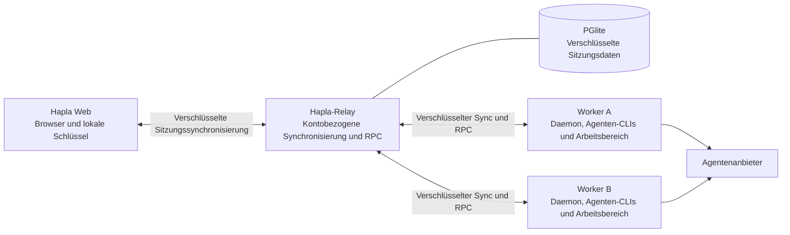

<div align="center">
  
  <h1>Hapla</h1>
  <p><strong>Codex und Claude Code direkt im Browser nutzen.</strong></p>
  <p>Eine selbst gehostete Arbeitsumgebung für Coding-Agenten, Projektdateien und Sitzungen auf deinen eigenen Rechnern.</p>
</div>

[English](../../README.md) · [简体中文](README.zh-CN.md) · [Français](README.fr.md) · **Deutsch** · [Español](README.es.md) · [日本語](README.ja.md) · [한국어](README.ko.md) · [Русский](README.ru.md) · [العربية](README.ar.md) · [Português](README.pt.md)

[Schnellstart](#quick-start) · [Modi Normal und Coder](#normal-and-coder-mode) · [Alltag](#everyday-workflow) · [Medien und Downloads](#media-and-downloads) · [Worker-Isolation](#isolate-cli-workers) · [Architektur](#architecture)

Beginne auf dem Rechner und setze dieselbe Unterhaltung auf dem Handy fort. Im Browser kannst du Befehle des Agenten prüfen, Projektdateien durchsuchen und Ergebnisse abspielen oder herunterladen. Der Agent läuft auf einem gekoppelten Rechner. Hapla synchronisiert den Verlauf über ein Relay, das du selbst betreiben kannst.


*Lokal laufendes Hapla mit einem Beispielprojekt und fiktiven Gesprächsdaten.*

<a name="quick-start"></a>

## Schnellstart

Installiere **Node.js 22+**, **Git** und **Docker mit Compose v2** und führe diese Befehle im Terminal aus.

```bash
git clone https://github.com/trillionmonster/hapla.git
cd hapla
./deploy.sh up --non-interactive
```

Das Skript baut Web-Client und Relay, erzeugt einen privaten Serverschlüssel und wartet auf den erfolgreichen Healthcheck. Es gibt die Browser-URL aus. Standardmäßig lauscht es auf der Loopback-Adresse und sucht ab Port `12345` nach einem freien Port. Weitere Aufrufe behalten Konfiguration und Datenbank bei. `./deploy.sh` startet den interaktiven Assistenten. Richte für den Zugriff vom Handy oder einem anderen Rechner eine erreichbare Web-URL ein und verwende für den Fernzugriff HTTPS. [Bereitstellungsoptionen](../quickstart.md)

### Anmelden und einen Worker koppeln

1. **Hapla öffnen.** Wähle **User key sign-in**. Erzeuge für ein neues Konto mit dem folgenden Befehl einen eigenen Schlüssel auf deinem Rechner, speichere ihn im Passwortmanager und füge ihn ins Formular ein. Die erste Anmeldung legt das Konto auf diesem Relay an. Verwende in anderen Browsern denselben Schlüssel und dieselbe Relay-URL.
2. **CLI-Worker koppeln.** Führe `hapla auth login` wie unten gezeigt aus. Öffne den ausgegebenen Link im bereits angemeldeten Browser und bestätige die Verbindung.
3. **Beim Agenten im Worker anmelden.** Codex hat eine eigene Anmeldung. Aktiviere die Gerätecode-Anmeldung in den Einstellungen deines ChatGPT-Kontos oder -Arbeitsbereichs und schließe sie im Browser ab. [Codex-Anmeldung](https://learn.chatgpt.com/docs/auth#login-on-headless-devices)
4. **Worker starten.** Sobald der Rechner unter **Machines** auftaucht, erstelle eine Sitzung mit diesem Rechner, einem Arbeitsverzeichnis und einem Agenten.

```bash
# Einmal pro Hapla-Konto ausführen. Bewahre das Ergebnis vertraulich auf.
node <<'JS'
const { randomBytes } = require('node:crypto')
let key
do {
  key = randomBytes(32).toString('base64url')
} while (key.includes('-'))
console.log(key)
JS

# Im Repository ausführen. Verwende für jede Person einen eigenen Worker-Namen.
./deploy.sh worker-add workstation
./deploy.sh worker-run workstation hapla auth login
./deploy.sh worker-run workstation codex login --device-auth
./deploy.sh worker-up workstation
```

<details>
<summary>Hapla-Anmeldung ansehen</summary>


</details>

Im Docker-Worker ist Codex enthalten. Für Claude Code setze `HAPLA_CLAUDE_CODE_VERSION` in der erzeugten privaten Worker-Konfiguration, baue mit `worker-up` neu und führe `./deploy.sh worker-run workstation claude auth login` aus. [CLI-Referenz zu Claude Code](https://code.claude.com/docs/en/cli-reference)

Wenn du **ein vorhandenes Repository, Dateien oder eine bestehende Agentenanmeldung** verwenden möchtest, starte Hapla CLI auf diesem Rechner. Setze `HAPLA_SERVER_URL` und `HAPLA_WEBAPP_URL` auf die ausgegebene URL. Führe in einer Hapla-Arbeitskopie mit installierten Abhängigkeiten `pnpm cli auth login` und `pnpm cli daemon start` aus. [CLI aus dem Quellcode](../../packages/hapla-cli/README.md) · [Worker-Konfiguration](../environment-isolation.md)

### Alles mit einem Codex-Prompt starten

Öffne Codex im geklonten Repository und füge diesen Prompt ein.

> Richte Hapla aus diesem Repository in einer isolierten lokalen Instanz namens `demo` ein. Führe zuerst `./deploy.sh up --instance demo --non-interactive` und dann `./deploy.sh --instance demo worker-add workstation` aus.
> Gib mir die Web-URL und begleite mich bei der Anmeldung, der Hapla-Kopplung und der Codex-Geräteautorisierung. Ich gebe meine Schlüssel und Codes selbst ein.
> Sobald ich beide Anmeldungen bestätigt habe, führe `./deploy.sh --instance demo worker-up workstation` und `./deploy.sh --instance demo status` aus. Zeig mir, wo ich im Web sehe, ob der Rechner online ist. Verwende bei allen Bereitstellungsbefehlen die Instanz `demo`.

Nach der ersten Kopplung und Anmeldung startet dieser Befehl Stack und Worker. Du kannst ihn auch von Codex ausführen lassen.

```bash
./deploy.sh up --instance demo --non-interactive && ./deploy.sh --instance demo worker-up workstation
```

<a name="normal-and-coder-mode"></a>

## Modi Normal und Coder

Beide Ansichten zeigen dieselbe Sitzung. Mit **`>_`** in der Werkzeugleiste wechselst du zwischen Normal und Coder. Diese Auswahl ist unabhängig von den Berechtigungen des Agenten.

| | Normal | Coder |
| --- | --- | --- |
| Unterhaltung | Prompts, Antworten, Anhänge und Ergebnisse | Dieselbe Unterhaltung mit detaillierten Werkzeugaktivitäten |
| Interaktion | Fragen, Freigabeanfragen und interaktive Skills | Dieselben Interaktionen mit Werkzeugeingaben und -ergebnissen |
| Arbeitsbereich | Web- und HTML-Vorschau | Vorschau, Dateibrowser und persistentes Terminal auf dem Worker |
| Einsatz | Aufgaben formulieren und Fortschritt prüfen, auch unterwegs | Befehle prüfen, Dateien durchsuchen und Fehler eingrenzen |


<details>
<summary>Tests im Browserterminal ansehen</summary>


</details>

<details>
<summary>Dieselbe Unterhaltung im Handyformat ansehen</summary>


</details>

<a name="everyday-workflow"></a>

## Alltag

1. Wähle unter **New session** den gekoppelten Rechner, das Projektverzeichnis und **Codex** oder **Claude Code**. Wenn die CLI es anbietet, wähle Modell und Denktiefe.
2. Formuliere eine klar abgegrenzte Aufgabe, etwa *„Ergänze einen Test, der abgelaufene Einladungen ablehnt. Führe die Einladungstests aus und fasse das Ergebnis zusammen.“*
3. Lies die Antwort in Normal. Wechsle zu Coder, um den Testbefehl zu prüfen, öffne **Files** für die Projektdateien oder **Terminal** für einen weiteren Befehl auf dem Worker. **Preview** zeigt lokale Webseiten oder HTML an.
4. Öffne dieselbe Unterhaltung später erneut. Hapla unterstützt auch die Vorschau kompatibler Bilder, Videos, Audiodateien und PDFs.

Klone für einen ersten Versuch ein öffentliches Repository in den Arbeitsbereich eines neuen Docker-Workers. Wähle in **New session** dann `/workspace/hapla` und frage *„Wie starte ich das Relay und die Weboberfläche? Zeige mir die Befehle und den Healthcheck.“*

```bash
./deploy.sh worker-run workstation git clone https://github.com/trillionmonster/hapla.git /workspace/hapla
```

Probiere einen Skill mit eigener Oberfläche in der Unterhaltung. **Character composer** kombiniert einen Codex-Skill mit einer MCP-App für die Auswahl von Referenzbildern und übergibt die bestätigte Auswahl an den nächsten Agenten-Turn. [Ausführbares Character-composer-Beispiel](../../examples/interactive-skills/character-composer/README.md) · [Interaktive Skills](../interactive-skills.md)

### Standardmodell festlegen

Öffne **Settings → New session defaults**. Wähle **Codex** oder **Claude Code** und danach **Model**, **Thinking depth** und **Permissions**. Codex bietet je nach Modell auch eine Einstellung für die Antwortgeschwindigkeit. **Environment default** überlässt die Modellwahl der CLI. Der Modellkatalog stammt von einem gekoppelten Rechner. Für einzelne Sitzungen kannst du die Vorgaben ändern.


### CLI aktualisieren

- **Codex in Hapla.** Öffne **Machines → dein Rechner → Codex CLI** und wähle **Update CLI** (`更新 CLI`). Hapla installiert auf dem Rechner die verwaltete Version und aktualisiert den Modellkatalog. Laufende Prozesse behalten ihre Version, neu gestartete Prozesse verwenden das Update. **Refresh models and effort levels** (`刷新模型与档位`) aktualisiert nur den Katalog. Die Webinstallation funktioniert unter Linux und macOS. Verwende unter Windows den Paketmanager. [Codex CLI aktualisieren](../codex-cli-update.md)
- **Aus Quellcode gebaute Hapla CLI.** Führe im Repository `git pull --ff-only` und `pnpm install --frozen-lockfile` aus. Wenn du die gebaute CLI nutzt, führe zusätzlich `pnpm --filter ./packages/hapla-cli build` aus. Starte den Daemon bei Gelegenheit neu. Für einen Docker-Worker führe nach dem Update erneut `worker-up` für diesen Worker aus. [CLI-Befehle](../../packages/hapla-cli/README.md)

### Sitzung fortsetzen

Öffne die Unterhaltung im Web erneut und sende deine nächste Nachricht. Beim Schließen des Browsers läuft der Worker weiter. **Sleep** beendet den Agentenprozess und speichert den Verlauf. Beim Öffnen einer ruhenden Unterhaltung bittet Hapla den ursprünglichen online erreichbaren Worker, den gespeicherten Codex-Thread oder die Claude-Code-Sitzung fortzusetzen. Der Verlauf bleibt offline lesbar. Starte den Worker wieder, um fortzufahren.

Die Hapla-Sitzungs-ID aus der URL kannst du auch auf dem ursprünglichen Worker verwenden.

```bash
hapla resume <hapla-session-id>
# Aus dem Hapla-Quellrepository ausführen.
pnpm cli resume <hapla-session-id>
```

[Sitzungslebenszyklus und Wiederherstellung](../session-lifecycle.md)

**Spracheingabe wird derzeit nicht unterstützt.** Wir freuen uns über Beiträge zu Mikrofoneingabe, Browserberechtigungen, Transkription und klaren Bedienelementen für die Audioverarbeitung. [Mitwirken](../../CONTRIBUTING.md)

<a name="media-and-downloads"></a>

## Medien und Downloads

- **Erzeugte Ergebnisse.** Hapla sammelt Artefakte neben den abgeschlossenen Schritten in der Unterhaltung. Erzeugte Bilder werden automatisch hochgeladen. Video- und Audiodateien aus dem Arbeitsbereich werden referenziert, sodass sich die Originale bei Bedarf öffnen lassen. Öffne eine Dateikarte für ein Ergebnis oder eine Sammlung für Zwischendateien.
- **Vorschau und Download.** Öffne **Coder → Files**. Spiele unterstützte Videos und Audiodateien ab, betrachte Bilder und PDFs oder lade Originaldateien in beliebigen Formaten herunter, sofern der Worker im Arbeitsbereich darauf zugreifen kann und die Übertragungslimits eingehalten werden. Ein passender Codec wird nur zum Abspielen benötigt.
- **Große Dateien.** Binde für wenig Bandbreite oder geringe Kosten einen privaten Dateidienst mit Cloudflare R2 an. Über temporäre signierte URLs lädt der Browser große Originale direkt aus R2 und entlastet das Relay. Direkter R2-Datenverkehr nach außen kostet keine Bandbreitengebühr. Für Speicher und Operationen können Kosten anfallen. Ein optionaler experimenteller Download-Worker kann bestehende signierte R2-URLs streamen. Der Durchsatz hängt von Bereitstellung und Client-Netz ab. [Cloudflare-Konfiguration](../cloudflare.md) · [R2-Preise](https://developers.cloudflare.com/r2/pricing/)


<details>
<summary>Dateibrowser und Audioplayer ansehen</summary>


</details>

Bitte den Agenten bei einer Medienprüfung um eine kurze Zusammenfassung und einen Link zur endgültigen Video- oder Audiodatei. Öffne den Link zur Vorschau oder lade das Original unter **Files** herunter.

Aktiviere einen vorhandenen kompatiblen R2-Dateidienst im Assistenten oder gib seine URL an.

```bash
./deploy.sh up --file-service https://files.example.com --non-interactive
```

Konfiguriere CORS im privaten Bucket für den genauen Origin des Hapla-Web-Clients, damit Downloads und das Springen im Medium HTTP-Range-Anfragen nutzen können. Hinterlege R2-Zugangsdaten im Dateidienst. Verwende lokal den authentifizierten Dateizugriff vom selben Origin. [CORS für private Buckets](../cloudflare.md#private-bucket-cors) · [Lokale Dateiauslieferung](../lan-file-delivery.md) · [Artefaktsammlungen](../artifact-collections.md)

<a name="architecture"></a>

## Architektur



- **Browser.** Entschlüsselt und zeigt Sitzungen, sendet Prompts und öffnet Werkzeuge. Der gekoppelte Browser kann den gespeicherten Verlauf auch ohne Verbindung zum Worker lesen.
- **Relay.** Authentifiziert Konten, speichert verschlüsselte Sitzungsdaten im integrierten PGlite und leitet Live-Updates und RPCs an den passenden Worker weiter.
- **CLI-Worker.** Meldet die Fähigkeiten des Rechners, führt Codex oder Claude Code mit eigenen Zugangsdaten aus und bedient Terminal- und Dateianfragen. Die Codeausführung und der Zugriff auf Agentenanbieter erfolgen hier.

### Verschlüsselung und Datengrenzen

| Zweck | Algorithmus |
| --- | --- |
| Sitzungsdaten mit einem Schlüssel pro Datensatz | AES-256-GCM |
| Ältere Sitzungsdaten | XSalsa20-Poly1305 über NaCl secretbox |
| Kopplung und Schutz der Inhaltsschlüssel | X25519-Schlüsselaustausch mit XSalsa20-Poly1305 über NaCl box |
| Anmeldung per Benutzerschlüssel | Ed25519-Signatur einer Challenge |

Die gekoppelten Clients behalten die Inhaltsschlüssel. Das Relay sieht Betriebsmetadaten wie Konto- und Sitzungskennungen, Sequenznummern und Zeitstempel. Anhänge und Originaldateien werden authentifiziert ausgeliefert. Konfigurierte Dateidienste können dabei die Dateidaten verarbeiten. Agentenanbieter erhalten die Prompts und den Kontext, die die CLI sendet. Nutze HTTPS für den Fernzugriff. [Datenschutz und Datenverarbeitung](../../PRIVACY.md) · [Bereitstellung](../deployment.md)

<a name="isolate-cli-workers"></a>

### CLI-Worker isolieren

Gib jeder Person ein eigenes Webkonto und einen eigenen Worker. Worker können sich Weboberfläche und Relay teilen und speichern Projektdateien und Anmeldedaten in getrennten Volumes. Dieses Beispiel richtet zwei Worker auf der Instanz `team` ein.

```bash
./deploy.sh up --instance team --non-interactive

# Jede Person verwendet ihre eigene Web- und Codex-Anmeldung.
for name in account-a account-b; do
  ./deploy.sh --instance team worker-add "$name" || break
  ./deploy.sh --instance team worker-run "$name" hapla auth login || break
  ./deploy.sh --instance team worker-run "$name" codex login --device-auth || break
  ./deploy.sh --instance team worker-up "$name" || break
done
```

Jeder Worker erhält ein Compose-Projekt, ein `/workspace`-Volume und ein Home-Volume für `.hapla`, `.codex` und `.claude`. Er läuft als Nicht-Root-Benutzer, hängt im Relay-Netz und bindet den Docker-Socket nicht ein. Getrennte `--instance`-Namen trennen auch Relays, Ports, Serverschlüssel und Datenbanken. Wenn Benutzer einander nicht vertrauen, schaffen separate Hosts oder VMs eine stärkere Grenze als ein gemeinsamer Kernel. [Umgebungsisolation](../environment-isolation.md)

## Mitwirken

Installiere die Entwicklungsabhängigkeiten mit `corepack enable` und `pnpm install --frozen-lockfile` und führe `pnpm build` aus. Das Repository enthält den [Web-Client](../../packages/hapla-web), die [CLI](../../packages/hapla-cli), das [Relay](../../packages/hapla-server) und das [gemeinsame Protokoll](../../packages/hapla-wire). Unter `deploy/` liegen Bereitstellungsvorlagen und die optionale Cloudflare-Dateiauslieferung. Die Standardbereitstellung nutzt Docker Compose und integriertes PGlite. [Entwicklung](../development.md) · [Tests](../testing.md) · [Repository-Struktur](../repository-layout.md)

[Dokumentation](../README.md) · [Konfiguration](../configuration.md) · [Cloudflare](../cloudflare.md) · [Wartungs-Skill](../../.agents/skills/hapla-maintenance/SKILL.md)

Issues und Pull Requests sind willkommen. Beachte Beitragsleitfaden und Verhaltenskodex. Melde Schwachstellen gemäß der Sicherheitsrichtlinie. [Beitragsleitfaden](../../CONTRIBUTING.md) · [Verhaltenskodex](../../CODE_OF_CONDUCT.md) · [Sicherheitsrichtlinie](../../SECURITY.md)

## Lizenz und Danksagung

Hapla ist Open Source unter der **MIT-Lizenz**. Das Projekt baut auf dem Original von **slopus/happy** auf und behält dessen MIT-Lizenz und Urheberrechtsvermerk bei. Danke an Slopus und alle Mitwirkenden von Happy, die ihre Arbeit veröffentlicht haben. [MIT-Lizenz](../../LICENSE) · [Happy-Upstream](https://github.com/slopus/happy)
