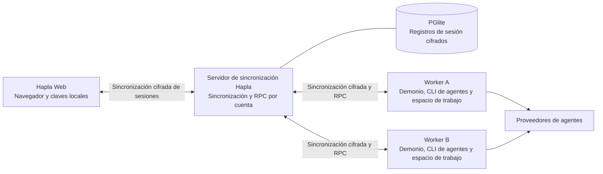

<div align="center">
  
  <h1>Hapla</h1>
  <p><strong>Ejecuta Codex y Claude Code desde tu navegador.</strong></p>
  <p>Un espacio de trabajo autoalojado para tus agentes de programación, archivos y sesiones en tus propias máquinas.</p>
</div>

[English](../../README.md) · [简体中文](README.zh-CN.md) · [Français](README.fr.md) · [Deutsch](README.de.md) · **Español** · [日本語](README.ja.md) · [한국어](README.ko.md) · [Русский](README.ru.md) · [العربية](README.ar.md) · [Português](README.pt.md)

[Inicio rápido](#quick-start) · [Modos Normal y Coder](#normal-and-coder-mode) · [Uso diario](#everyday-workflow) · [Multimedia y descargas](#media-and-downloads) · [Aislamiento de workers](#isolate-cli-workers) · [Arquitectura](#architecture)

Empieza a programar en una estación de trabajo y retoma la misma conversación desde el móvil. En el navegador puedes inspeccionar los comandos que ejecutó el agente, explorar el proyecto y reproducir o descargar los resultados. El agente se ejecuta en una máquina vinculada. Hapla sincroniza el historial mediante un servidor que puedes alojar tú mismo.


*Hapla ejecutándose en local con un proyecto de ejemplo y datos de conversación ficticios.*

<a name="quick-start"></a>

## Inicio rápido

Instala **Node.js 22+**, **Git** y **Docker con Compose v2**, y ejecuta estos comandos en la terminal.

```bash
git clone https://github.com/trillionmonster/hapla.git
cd hapla
./deploy.sh up --non-interactive
```

El script construye el cliente web y el servidor, genera una clave privada y espera a que pase la comprobación de estado. Muestra la URL del navegador y, de forma predeterminada, solo escucha en la interfaz de bucle local, buscando un puerto libre desde el `12345`. Las ejecuciones posteriores conservan la configuración y la base de datos. Usa `./deploy.sh` para abrir el asistente interactivo. Para acceder desde el móvil u otra máquina, configura una URL accesible y usa HTTPS para el acceso remoto. [Opciones de despliegue](../quickstart.md)

### Iniciar sesión y vincular un worker

1. **Abre Hapla.** Elige **User key sign-in**. Para crear una cuenta, genera una clave única en tu equipo con el comando de abajo, guárdala en un gestor de contraseñas y pégala en el formulario. El primer inicio de sesión crea la cuenta en ese servidor. Usa la misma clave y URL del servidor cuando entres desde otro navegador.
2. **Vincula un worker de CLI.** Ejecuta `hapla auth login` como se indica abajo, abre el enlace que se muestra en el navegador donde ya estás conectado y aprueba la conexión.
3. **Inicia sesión en el agente desde el worker.** Codex requiere su propia autenticación. Habilita los códigos de dispositivo en la configuración de tu cuenta o espacio de trabajo de ChatGPT y completa el proceso en el navegador. [Autenticación de Codex](https://learn.chatgpt.com/docs/auth#login-on-headless-devices)
4. **Arranca el worker.** Cuando aparezca en **Machines**, crea una sesión con esa máquina, un directorio de trabajo y un agente.

```bash
# Una vez por cuenta de Hapla. Guarda el resultado de forma privada.
node <<'JS'
const { randomBytes } = require('node:crypto')
let key
do {
  key = randomBytes(32).toString('base64url')
} while (key.includes('-'))
console.log(key)
JS

# Desde el repositorio. Usa un nombre de worker distinto por usuario.
./deploy.sh worker-add workstation
./deploy.sh worker-run workstation hapla auth login
./deploy.sh worker-run workstation codex login --device-auth
./deploy.sh worker-up workstation
```

<details>
<summary>Ver la pantalla de inicio de sesión de Hapla</summary>


</details>

El worker de Docker incluye Codex. Para añadir Claude Code, configura `HAPLA_CLAUDE_CODE_VERSION` en la configuración privada que se ha generado, reconstruye con `worker-up` y ejecuta `./deploy.sh worker-run workstation claude auth login`. [Referencia de la CLI de Claude Code](https://code.claude.com/docs/en/cli-reference)

Para usar **un repositorio, archivos o una sesión del agente que ya existen** en un equipo, ejecuta Hapla CLI allí. Configura `HAPLA_SERVER_URL` y `HAPLA_WEBAPP_URL` con la URL que muestra el despliegue. Desde una copia del código de Hapla con las dependencias instaladas, ejecuta `pnpm cli auth login` y `pnpm cli daemon start`. [CLI desde el código fuente](../../packages/hapla-cli/README.md) · [Configuración de workers](../environment-isolation.md)

### Arrancar todo con una instrucción para Codex

Abre Codex en el repositorio clonado y pega esta instrucción.

> Configura Hapla desde este repositorio en una instancia local aislada llamada `demo`. Ejecuta `./deploy.sh up --instance demo --non-interactive` y luego `./deploy.sh --instance demo worker-add workstation`.
> Indícame la URL web y guíame por el inicio de sesión, la vinculación de Hapla y la autorización de dispositivo para Codex. Yo introduzco mis claves y códigos.
> Cuando confirme ambos inicios de sesión, ejecuta `./deploy.sh --instance demo worker-up workstation`, comprueba `./deploy.sh --instance demo status` y dime dónde confirmar en la web que la máquina está en línea. Usa la instancia `demo` en cada comando de despliegue.

Tras vincular el worker e iniciar sesión por primera vez, este comando arranca el conjunto de servicios y el worker. También puedes pedir a Codex que lo ejecute.

```bash
./deploy.sh up --instance demo --non-interactive && ./deploy.sh --instance demo worker-up workstation
```

<a name="normal-and-coder-mode"></a>

## Modos Normal y Coder

Las dos vistas usan la misma sesión. Selecciona **`>_`** en la barra de herramientas para cambiar de modo. La vista se elige por separado de los permisos del agente.

| | Normal | Coder |
| --- | --- | --- |
| Conversación | Instrucciones, respuestas, adjuntos y resultados | La misma conversación con actividad detallada de herramientas |
| Interacción | Preguntas, solicitudes de aprobación y Skills interactivas | Las mismas interacciones con entradas y resultados de herramientas |
| Espacio de trabajo | Vista previa web y HTML | Vistas previas, explorador de archivos y terminal persistente en el worker |
| Uso | Orientar el trabajo y revisar el avance, también desde el móvil | Inspeccionar comandos, explorar archivos y diagnosticar resultados |


<details>
<summary>Ver las pruebas en la terminal del navegador</summary>


</details>

<details>
<summary>Ver la misma conversación en un navegador móvil</summary>


</details>

<a name="everyday-workflow"></a>

## Uso diario

1. En **New session**, elige la máquina vinculada, el directorio del proyecto y **Codex** o **Claude Code**. Selecciona un modelo y un nivel de razonamiento si la CLI los ofrece.
2. Envía una tarea concreta, por ejemplo *«Añade una prueba que rechace las invitaciones vencidas. Ejecuta las pruebas de invitaciones y resume el resultado.»*
3. Lee la respuesta en modo Normal. Cambia a Coder para revisar el comando, abre **Files** para explorar el proyecto o usa **Terminal** para ejecutar otro comando en el worker. **Preview** muestra una página local o un archivo HTML.
4. Vuelve a abrir la misma conversación para continuar. Hapla también permite previsualizar imágenes, vídeos, audio y PDF compatibles.

Para probar un worker Docker nuevo, clona un repositorio público en su espacio de trabajo. En **New session**, elige `/workspace/hapla` y pregunta *«¿Cómo se inician el servidor y la interfaz web? Muéstrame los comandos y la comprobación de estado.»*

```bash
./deploy.sh worker-run workstation git clone https://github.com/trillionmonster/hapla.git /workspace/hapla
```

Prueba una Skill con interfaz dentro de la conversación. **Character composer** combina una Skill de Codex con una aplicación MCP para elegir imágenes de referencia y envía la selección confirmada al siguiente turno. [Ejemplo ejecutable de Character composer](../../examples/interactive-skills/character-composer/README.md) · [Skills interactivas](../interactive-skills.md)

### Elegir el modelo predeterminado

Abre **Settings → New session defaults**. Elige **Codex** o **Claude Code** y configura **Model**, **Thinking depth** y **Permissions**. Codex también permite elegir la velocidad de respuesta según el modelo. **Environment default** deja que la CLI elija el modelo. El catálogo procede de una máquina vinculada y puedes cambiar la configuración para cada sesión.


### Actualizar la CLI

- **Codex en Hapla.** Abre **Machines → tu máquina → Codex CLI** y selecciona **Update CLI** (`更新 CLI`). Hapla instala la versión gestionada en esa máquina y actualiza su catálogo. Los procesos ya activos conservan su versión y los nuevos usan la actualizada. **Refresh models and effort levels** (`刷新模型与档位`) solo sincroniza el catálogo. La instalación web es compatible con Linux y macOS. En Windows, usa el gestor de paquetes. [Actualizar Codex CLI](../codex-cli-update.md)
- **Hapla CLI compilada desde el código fuente.** Ejecuta `git pull --ff-only` y `pnpm install --frozen-lockfile` en el repositorio. Si usas la CLI compilada, ejecuta también `pnpm --filter ./packages/hapla-cli build`. Reinicia el demonio cuando te convenga. En un worker Docker, vuelve a ejecutar `worker-up` para ese worker después de actualizar el repositorio. [Comandos de CLI](../../packages/hapla-cli/README.md)

### Continuar una sesión

Reabre la conversación en la web y envía el próximo mensaje. El worker sigue funcionando al cerrar el navegador. **Sleep** libera el proceso del agente y conserva el historial. Al abrir una conversación suspendida, Hapla pide al worker original, si está en línea, que reanude el hilo de Codex o la sesión de Claude Code guardados. El historial sigue siendo legible sin conexión. Inicia de nuevo el worker para continuar.

También puedes usar en el worker original el ID de sesión de Hapla que figura en la URL de la conversación.

```bash
hapla resume <hapla-session-id>
# Desde el repositorio de código fuente de Hapla.
pnpm cli resume <hapla-session-id>
```

[Ciclo de vida y recuperación de sesiones](../session-lifecycle.md)

**La entrada de voz aún no está disponible.** Buscamos colaboradores para desarrollar y probar la entrada por micrófono, los permisos del navegador, la transcripción y los controles de tratamiento de audio. [Contribuir](../../CONTRIBUTING.md)

<a name="media-and-downloads"></a>

## Multimedia y descargas

- **Resultados generados.** Hapla agrupa los artefactos junto a los pasos completados de la conversación. Las imágenes generadas se suben automáticamente. Los vídeos y audios del espacio de trabajo se referencian para abrir sus originales bajo demanda. Abre una tarjeta para ver un resultado o despliega una colección para consultar los archivos intermedios.
- **Vista previa y descarga.** Abre **Coder → Files** para explorar el espacio de trabajo. Reproduce audio y vídeo compatibles, previsualiza imágenes y PDF o descarga archivos originales en cualquier formato al que el worker pueda acceder en su espacio de trabajo, dentro de los límites de transferencia. Solo la reproducción requiere un códec compatible.
- **Archivos grandes.** Conecta un servicio de archivos privado con Cloudflare R2 para gastar menos ancho de banda del servidor. Las URL firmadas temporales permiten descargar originales directamente de R2. La salida directa de R2 no tiene cargos por ancho de banda. El almacenamiento y las operaciones pueden tener costes. El Worker de descarga experimental puede transmitir datos de URL firmadas de R2 existentes. La velocidad depende del despliegue y de la red del cliente. [Configuración de Cloudflare](../cloudflare.md) · [Precios de R2](https://developers.cloudflare.com/r2/pricing/)


<details>
<summary>Ver el explorador de archivos y el reproductor de audio</summary>


</details>

Para revisar contenido multimedia, pide al agente que resuma el resultado y enlace el vídeo o audio final. Abre el enlace para previsualizarlo o descarga el original desde **Files**.

Activa un servicio compatible de R2 que ya tengas mediante el asistente de despliegue, o indica su URL en el comando.

```bash
./deploy.sh up --file-service https://files.example.com --non-interactive
```

Configura CORS en el bucket privado con el origen exacto del cliente web de Hapla para que las descargas y la búsqueda en medios puedan usar solicitudes HTTP Range. Guarda las credenciales de R2 en el servicio de archivos. Para la entrega local, usa la ruta de archivos autenticada del mismo origen. [CORS del bucket privado](../cloudflare.md#private-bucket-cors) · [Entrega local de archivos](../lan-file-delivery.md) · [Colecciones de artefactos](../artifact-collections.md)

<a name="architecture"></a>

## Arquitectura



- **Navegador.** Descifra y muestra las sesiones, envía instrucciones y abre las herramientas. Un navegador vinculado puede leer el historial guardado aunque el worker se desconecte.
- **Servidor de sincronización.** Autentica cuentas, guarda las sesiones cifradas en PGlite integrado y encamina las actualizaciones y las RPC al worker adecuado.
- **Worker de CLI.** Publica las capacidades de la máquina, ejecuta Codex o Claude Code con sus propias credenciales y atiende las peticiones de terminal y del espacio de trabajo. El código se ejecuta y se comunica con el proveedor en el worker.

### Cifrado y límites de acceso a datos

| Uso | Algoritmo |
| --- | --- |
| Datos de sesión con una clave por registro | AES-256-GCM |
| Datos de sesión heredados | XSalsa20-Poly1305 mediante NaCl secretbox |
| Vinculación y encapsulado de claves de contenido | Acuerdo de claves X25519 con XSalsa20-Poly1305 mediante NaCl box |
| Autenticación por clave de usuario | Firma del desafío con Ed25519 |

Los clientes vinculados conservan las claves de contenido. El servidor ve metadatos operativos como los identificadores de cuenta y sesión, números de secuencia y marcas de tiempo. Los adjuntos y originales siguen una ruta autenticada en la que los servicios de archivo configurados pueden procesar los bytes. Los proveedores de agentes reciben las instrucciones y el contexto que envía la CLI. Usa HTTPS en instalaciones remotas. [Privacidad y tratamiento de datos](../../PRIVACY.md) · [Despliegue](../deployment.md)

<a name="isolate-cli-workers"></a>

### Aislar los workers de CLI

Asigna una cuenta web y un worker distintos a cada usuario. Los workers pueden compartir la interfaz web y el servidor de sincronización con volúmenes separados para los archivos y el estado de inicio de sesión. Por ejemplo, configura dos workers en la instancia `team`.

```bash
./deploy.sh up --instance team --non-interactive

# Cada usuario usa sus propias cuentas de la web y de Codex.
for name in account-a account-b; do
  ./deploy.sh --instance team worker-add "$name" || break
  ./deploy.sh --instance team worker-run "$name" hapla auth login || break
  ./deploy.sh --instance team worker-run "$name" codex login --device-auth || break
  ./deploy.sh --instance team worker-up "$name" || break
done
```

Cada worker tiene un proyecto Compose propio, un volumen `/workspace` y un volumen personal para `.hapla`, `.codex` y `.claude`. Se ejecuta sin privilegios de root y se conecta a la red del servidor sin montar el socket de Docker. Usa nombres `--instance` distintos para separar también servidores, puertos, claves y bases de datos. Para usuarios que no confían entre sí, usa hosts o máquinas virtuales independientes y evita compartir el núcleo. [Aislamiento de entornos](../environment-isolation.md)

## Contribuir

Prepara las dependencias con `corepack enable` y `pnpm install --frozen-lockfile` y luego ejecuta `pnpm build`. El repositorio contiene el [cliente web](../../packages/hapla-web), la [CLI](../../packages/hapla-cli), el [servidor de sincronización](../../packages/hapla-server) y el [protocolo compartido](../../packages/hapla-wire). En `deploy/` están las plantillas y la integración opcional con Cloudflare. El despliegue habitual usa Docker Compose y PGlite integrado. [Desarrollo](../development.md) · [Pruebas](../testing.md) · [Estructura del repositorio](../repository-layout.md)

[Índice de documentación](../README.md) · [Configuración](../configuration.md) · [Cloudflare](../cloudflare.md) · [Skill de mantenimiento](../../.agents/skills/hapla-maintenance/SKILL.md)

Aceptamos incidencias y pull requests. Sigue la guía de contribución y el código de conducta. Usa la política de seguridad para comunicar vulnerabilidades. [Guía de contribución](../../CONTRIBUTING.md) · [Código de conducta](../../CODE_OF_CONDUCT.md) · [Política de seguridad](../../SECURITY.md)

## Licencia y agradecimientos

Hapla es código abierto bajo la **licencia MIT**. Se basa en la implementación original de **slopus/happy** y conserva la licencia MIT y el aviso de derechos de autor del proyecto original. Gracias a Slopus y a quienes contribuyen a Happy por publicar su trabajo. [Licencia MIT](../../LICENSE) · [Proyecto Happy original](https://github.com/slopus/happy)
