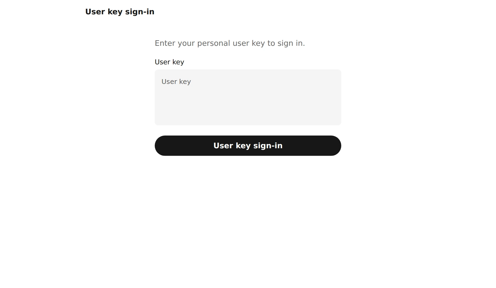
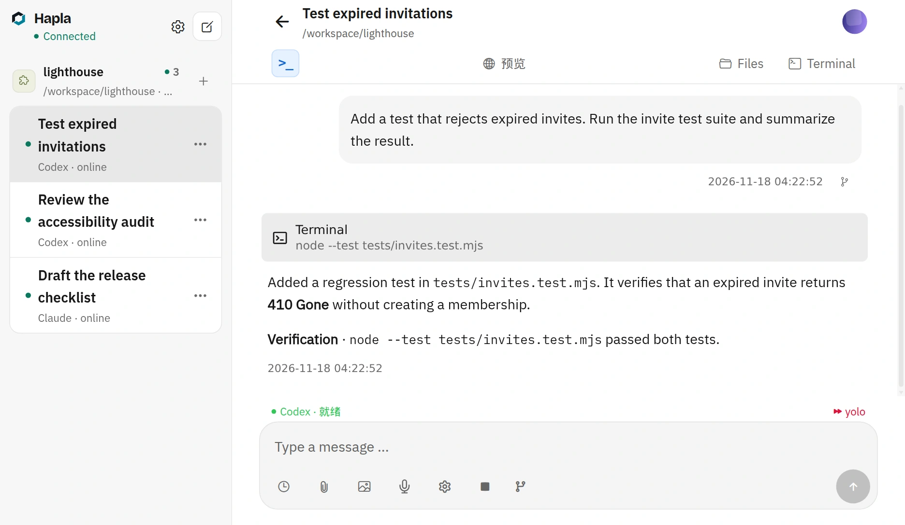
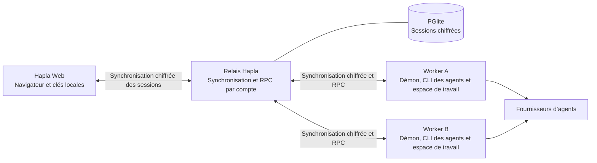

<div align="center">
  
  <h1>Hapla</h1>
  <p><strong>Exécutez Codex et Claude Code depuis votre navigateur.</strong></p>
  <p>Un espace de travail auto-hébergé pour vos agents de développement, vos fichiers et vos sessions sur vos propres machines.</p>
</div>

[English](../../README.md) · [简体中文](README.zh-CN.md) · **Français** · [Deutsch](README.de.md) · [Español](README.es.md) · [日本語](README.ja.md) · [한국어](README.ko.md) · [Русский](README.ru.md) · [العربية](README.ar.md) · [Português](README.pt.md)

[Démarrage rapide](#quick-start) · [Modes Normal et Coder](#normal-and-coder-mode) · [Utilisation quotidienne](#everyday-workflow) · [Médias et téléchargements](#media-and-downloads) · [Isolation des workers](#isolate-cli-workers) · [Architecture](#architecture)

Commencez à coder sur un poste de travail et reprenez la même conversation sur votre téléphone. Le navigateur permet d’inspecter les commandes exécutées par l’agent, de parcourir les fichiers du projet et de lire ou télécharger les résultats. L’agent s’exécute sur une machine associée. Hapla synchronise l’historique via un relais que vous pouvez héberger.


*Hapla en local avec un projet d’exemple et des données de conversation fictives.*

<a name="quick-start"></a>

## Démarrage rapide

Installez **Node.js 22+**, **Git** et **Docker avec Compose v2**, puis exécutez ces commandes dans un terminal.

```bash
git clone https://github.com/trillionmonster/hapla.git
cd hapla
./deploy.sh up --non-interactive
```

Le script construit le client Web et le relais, génère une clé privée pour le serveur et attend la réussite du contrôle de santé. Il affiche l’URL du navigateur. Par défaut, l’écoute se limite à l’interface de bouclage et la recherche d’un port libre commence à `12345`. Les exécutions suivantes conservent la configuration et la base de données. Lancez `./deploy.sh` pour l’assistant interactif. Pour un autre appareil, configurez une URL Web accessible et utilisez HTTPS pour l’accès distant. [Options de déploiement](../quickstart.md)

### Se connecter et associer un worker

1. **Ouvrez Hapla.** Choisissez **User key sign-in**. Pour un nouveau compte, générez une clé unique sur votre machine avec la commande ci-dessous, enregistrez-la dans votre gestionnaire de mots de passe puis collez-la dans le formulaire. La première connexion crée le compte sur ce relais. Réutilisez la même clé et la même URL du relais sur un autre navigateur.
2. **Associez un worker CLI.** Lancez `hapla auth login` comme ci-dessous. Ouvrez le lien affiché dans le navigateur où vous êtes connecté et approuvez la connexion.
3. **Connectez votre agent sur le worker.** Codex a sa propre authentification. Activez la connexion par code d’appareil dans les paramètres de votre compte ChatGPT ou de votre espace de travail, puis suivez les étapes dans le navigateur. [Authentification Codex](https://learn.chatgpt.com/docs/auth#login-on-headless-devices)
4. **Démarrez le worker.** Lorsque la machine apparaît dans **Machines**, créez une session en la sélectionnant avec un dossier de travail et un agent.

```bash
# Une fois par compte Hapla. Gardez le résultat confidentiel.
node <<'JS'
const { randomBytes } = require('node:crypto')
let key
do {
  key = randomBytes(32).toString('base64url')
} while (key.includes('-'))
console.log(key)
JS

# Depuis le dépôt. Utilisez un nom de worker distinct par personne.
./deploy.sh worker-add workstation
./deploy.sh worker-run workstation hapla auth login
./deploy.sh worker-run workstation codex login --device-auth
./deploy.sh worker-up workstation
```

<details>
<summary>Voir l’écran de connexion Hapla</summary>



</details>

Le worker Docker embarque Codex. Pour ajouter Claude Code, renseignez `HAPLA_CLAUDE_CODE_VERSION` dans sa configuration privée générée, reconstruisez le worker avec `worker-up`, puis lancez `./deploy.sh worker-run workstation claude auth login`. [Référence de la CLI Claude Code](https://code.claude.com/docs/en/cli-reference)

Pour utiliser **un dépôt, des fichiers ou une connexion à un agent déjà présents** sur une machine, lancez-y la CLI Hapla. Donnez à `HAPLA_SERVER_URL` et `HAPLA_WEBAPP_URL` l’URL affichée par le déploiement. Dans un dépôt Hapla dont les dépendances sont installées, lancez `pnpm cli auth login` et `pnpm cli daemon start`. [CLI depuis les sources](../../packages/hapla-cli/README.md) · [Configuration des workers](../environment-isolation.md)

### Tout démarrer avec une consigne Codex

Ouvrez Codex dans le dépôt cloné et collez cette consigne.

> Configure Hapla à partir de ce dépôt dans une instance locale isolée appelée `demo`. Lance `./deploy.sh up --instance demo --non-interactive`, puis `./deploy.sh --instance demo worker-add workstation`.
> Indique-moi l’URL Web et guide-moi dans la connexion, l’association Hapla et l’autorisation de l’appareil dans Codex. Je saisis moi-même mes clés et mes codes.
> Quand je confirme les deux connexions, lance `./deploy.sh --instance demo worker-up workstation` et vérifie `./deploy.sh --instance demo status`. Montre-moi où vérifier dans l’interface Web que la machine est en ligne. Utilise l’instance `demo` pour chaque commande de déploiement.

Une fois le worker associé et connecté, cette commande démarre le déploiement et le worker. Codex peut l’exécuter pour vous.

```bash
./deploy.sh up --instance demo --non-interactive && ./deploy.sh --instance demo worker-up workstation
```

<a name="normal-and-coder-mode"></a>

## Modes Normal et Coder

Les deux vues ouvrent la même session. Cliquez sur **`>_`** dans la barre d’outils pour basculer entre Normal et Coder. Le choix de la vue est indépendant des permissions de l’agent.

| | Normal | Coder |
| --- | --- | --- |
| Conversation | Consignes, réponses, pièces jointes et résultats | Même conversation avec le détail de l’activité des outils |
| Interaction | Questions, demandes d’approbation et Skills interactifs | Mêmes interactions avec les entrées et résultats des outils |
| Espace de travail | Aperçus Web et HTML | Aperçus, explorateur de fichiers et terminal persistant sur le worker |
| Usage | Donner des instructions et suivre l’avancement, y compris sur mobile | Examiner les commandes, parcourir les fichiers et diagnostiquer les résultats |



<details>
<summary>Voir les tests dans le terminal du navigateur</summary>


</details>

<details>
<summary>Voir la conversation dans un navigateur au format téléphone</summary>


</details>

<a name="everyday-workflow"></a>

## Utilisation quotidienne

1. Dans **New session**, choisissez la machine associée, le dossier du projet et **Codex** ou **Claude Code**. Sélectionnez un modèle et un niveau de réflexion si la CLI les propose.
2. Donnez une tâche précise, par exemple *« Ajoute un test qui rejette les invitations expirées. Lance la suite de tests des invitations et résume les résultats. »*
3. Lisez la réponse en mode Normal. Passez en mode Coder pour examiner la commande, ouvrez **Files** pour lire le projet ou utilisez **Terminal** pour lancer une commande sur le worker. **Preview** affiche une page Web locale ou un fichier HTML.
4. Rouvrez la conversation pour la poursuivre. Hapla prévisualise aussi les images, les vidéos, les fichiers audio et les PDF compatibles.

Pour essayer un worker Docker neuf, clonez un dépôt public dans son espace de travail. Dans **New session**, choisissez `/workspace/hapla` puis demandez *« Comment démarrer le relais et l’interface Web ? Donne-moi les commandes et le contrôle de santé. »*

```bash
./deploy.sh worker-run workstation git clone https://github.com/trillionmonster/hapla.git /workspace/hapla
```

Essayez également un Skill doté d’une interface dans la conversation. **Character composer** associe un Skill Codex à une application MCP permettant de choisir des images de référence, puis transmet la sélection validée au tour suivant. [Exemple exécutable Character composer](../../examples/interactive-skills/character-composer/README.md) · [Skills interactifs](../interactive-skills.md)

### Choisir le modèle par défaut

Ouvrez **Settings → New session defaults**. Choisissez **Codex** ou **Claude Code**, puis **Model**, **Thinking depth** et **Permissions**. Codex propose aussi une préférence de vitesse selon les capacités du modèle. **Environment default** confie le choix du modèle à la CLI. Le catalogue vient d’une machine associée, et les valeurs par défaut peuvent être adaptées pour chaque session.


### Mettre à jour la CLI

- **Codex utilisé par Hapla.** Ouvrez **Machines → votre machine → Codex CLI**, puis choisissez **Update CLI** (`更新 CLI`). Hapla installe la version gérée sur cette machine et actualise son catalogue. Les processus Codex déjà en cours gardent leur version et les nouveaux utilisent la version mise à jour. **Refresh models and effort levels** (`刷新模型与档位`) actualise uniquement le catalogue. L’installation Web fonctionne sous Linux et macOS. Sous Windows, utilisez le gestionnaire de paquets. [Mises à jour de la CLI Codex](../codex-cli-update.md)
- **CLI Hapla compilée depuis les sources.** Lancez `git pull --ff-only` et `pnpm install --frozen-lockfile` dans le dépôt, puis `pnpm --filter ./packages/hapla-cli build` si vous utilisez la CLI compilée. Redémarrez le démon au moment qui vous convient. Pour un worker Docker, relancez `worker-up` sur ce worker après la mise à jour du dépôt. [Commandes CLI](../../packages/hapla-cli/README.md)

### Reprendre une session

Rouvrez la conversation dans le navigateur et envoyez votre prochain message. Le worker continue à tourner après la fermeture du navigateur. Avec **Sleep**, Hapla libère le processus de l’agent et conserve l’historique. La réouverture demande au worker d’origine, s’il est en ligne, de reprendre le fil Codex ou la session Claude Code enregistrée. L’historique reste lisible hors ligne et vous pouvez redémarrer le worker pour poursuivre le travail.

Vous pouvez aussi utiliser l’identifiant de session Hapla, visible dans l’URL de la conversation, sur le worker d’origine.

```bash
hapla resume <hapla-session-id>
# Depuis le dépôt source de Hapla.
pnpm cli resume <hapla-session-id>
```

[Cycle de vie et récupération des sessions](../session-lifecycle.md)

**La saisie vocale est indisponible pour le moment.** Nous invitons les contributeurs à développer et tester l’accès au microphone, les autorisations du navigateur, la transcription et les contrôles de traitement audio. [Contribuer](../../CONTRIBUTING.md)

<a name="media-and-downloads"></a>

## Médias et téléchargements

- **Fichiers générés.** Hapla regroupe les livrables près des étapes terminées dans la conversation. Les images générées sont téléversées automatiquement. Les vidéos et fichiers audio de l’espace de travail sont référencés et leurs originaux s’ouvrent à la demande. Cliquez sur une carte pour examiner le résultat ou ouvrez une collection pour voir les fichiers intermédiaires.
- **Prévisualiser et télécharger.** Ouvrez **Coder → Files**. Vous pouvez lire les vidéos et pistes audio compatibles, prévisualiser les images et PDF, et télécharger tout fichier d’origine accessible au worker dans son espace de travail, dans les limites de transfert du déploiement. Seule la lecture multimédia nécessite un codec compatible.
- **Fichiers volumineux.** Associez un service de fichiers adossé à un compartiment Cloudflare R2 privé. Les URL signées temporaires permettent au navigateur de télécharger les originaux depuis R2 et soulagent le relais. Le trafic sortant direct est gratuit. Le stockage et les opérations peuvent être facturés. Un Worker de téléchargement expérimental peut transmettre le flux d’une URL R2 signée existante. Le débit dépend du déploiement et du réseau du client. [Configuration Cloudflare](../cloudflare.md) · [Tarification R2](https://developers.cloudflare.com/r2/pricing/)


<details>
<summary>Voir l’explorateur de fichiers et le lecteur audio</summary>


</details>

Pour une revue, demandez à l’agent de résumer ses résultats et de fournir le lien vers la vidéo ou l’audio final. Ouvrez ce lien pour l’aperçu ou téléchargez l’original depuis **Files**.

Ajoutez l’URL d’un service compatible existant dans l’assistant de déploiement ou passez-la dans la commande.

```bash
./deploy.sh up --file-service https://files.example.com --non-interactive
```

Configurez CORS sur le compartiment privé avec l’origine exacte du client Web Hapla pour les téléchargements et les requêtes HTTP Range de la lecture multimédia. Conservez les identifiants R2 dans le service de fichiers. En local, utilisez le point d’accès aux fichiers authentifié de même origine. [CORS du compartiment privé](../cloudflare.md#private-bucket-cors) · [Livraison locale des fichiers](../lan-file-delivery.md) · [Collections de livrables](../artifact-collections.md)

<a name="architecture"></a>

## Architecture



- **Navigateur.** Déchiffre et affiche les sessions, envoie les consignes et ouvre les outils de l’espace de travail. Un navigateur associé peut lire l’historique conservé même si le worker est déconnecté.
- **Relais.** Authentifie les comptes, stocke les sessions chiffrées dans PGlite embarqué et achemine les mises à jour et RPC vers le worker concerné.
- **Worker CLI.** Publie les capacités de la machine, exécute Codex ou Claude Code avec ses propres identifiants et traite les requêtes de terminal et de fichiers. Le worker exécute le code et communique avec le fournisseur de l’agent.

### Chiffrement et périmètres de données

| Usage | Algorithme |
| --- | --- |
| Données de session avec clé propre à chaque enregistrement | AES-256-GCM |
| Données de session héritées | XSalsa20-Poly1305 via NaCl secretbox |
| Association et protection des clés de contenu | Échange de clés X25519 avec XSalsa20-Poly1305 via NaCl box |
| Authentification par clé utilisateur | Signature de défi Ed25519 |

Les clients associés conservent les clés de contenu. Le relais accède aux métadonnées opérationnelles, dont les identifiants de compte et de session, les numéros de séquence et les horodatages. Les pièces jointes et les originaux suivent un circuit authentifié, où les services de fichiers configurés peuvent traiter les octets. Les fournisseurs d’agents reçoivent les consignes et le contexte transmis par la CLI. Utilisez HTTPS pour les installations distantes. [Confidentialité et données](../../PRIVACY.md) · [Déploiement](../deployment.md)

<a name="isolate-cli-workers"></a>

### Isoler les workers CLI

Créez un compte Web et un worker distincts par utilisateur. Les workers peuvent partager un déploiement Web et un relais, avec leurs fichiers et leurs identifiants dans des volumes séparés. Voici deux workers sur une instance `team`.

```bash
./deploy.sh up --instance team --non-interactive

# Chaque personne utilise ses propres identifiants Web et Codex.
for name in account-a account-b; do
  ./deploy.sh --instance team worker-add "$name" || break
  ./deploy.sh --instance team worker-run "$name" hapla auth login || break
  ./deploy.sh --instance team worker-run "$name" codex login --device-auth || break
  ./deploy.sh --instance team worker-up "$name" || break
done
```

Chaque worker a son projet Compose, son volume `/workspace` et son volume personnel pour `.hapla`, `.codex` et `.claude`. Il s’exécute sans privilèges root et rejoint le réseau du relais sans montage de la socket Docker. Utilisez des noms `--instance` distincts pour isoler aussi les relais, ports, clés serveur et bases de données. Pour des utilisateurs qui ne se font pas confiance, des hôtes ou machines virtuelles dédiés offrent une isolation au-delà du noyau partagé. [Isolation des environnements](../environment-isolation.md)

## Contribuer

Installez les dépendances avec `corepack enable` et `pnpm install --frozen-lockfile`, puis lancez `pnpm build`. Le dépôt contient le [client Web](../../packages/hapla-web), la [CLI](../../packages/hapla-cli), le [relais](../../packages/hapla-server) et le [protocole partagé](../../packages/hapla-wire). Les modèles de déploiement et l’intégration Cloudflare facultative figurent dans `deploy/`. Le déploiement par défaut repose sur Docker Compose et PGlite embarqué. [Développement](../development.md) · [Tests](../testing.md) · [Organisation du dépôt](../repository-layout.md)

[Index de la documentation](../README.md) · [Configuration](../configuration.md) · [Cloudflare](../cloudflare.md) · [Skill de maintenance](../../.agents/skills/hapla-maintenance/SKILL.md)

Les tickets et les pull requests sont les bienvenus. Suivez le guide de contribution et le code de conduite, et utilisez la politique de sécurité pour signaler les vulnérabilités. [Guide de contribution](../../CONTRIBUTING.md) · [Code de conduite](../../CODE_OF_CONDUCT.md) · [Politique de sécurité](../../SECURITY.md)

## Licence et remerciements

Hapla est un projet open source sous **licence MIT**. Il s’appuie sur l’implémentation originale de **slopus/happy** et conserve sa licence MIT et sa notice de droit d’auteur. Merci à Slopus et aux contributeurs de Happy d’avoir publié ce travail. [Licence MIT](../../LICENSE) · [Projet Happy d’origine](https://github.com/slopus/happy)
