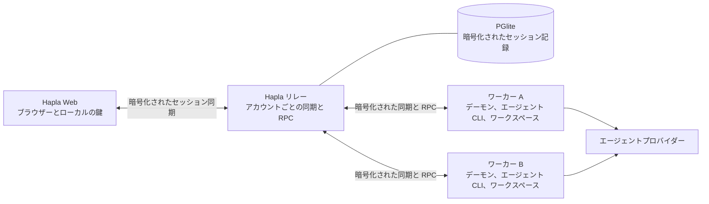

<div align="center">
  
  <h1>Hapla</h1>
  <p><strong>ブラウザーから Codex と Claude Code を使う。</strong></p>
  <p>自分のマシンで動くコーディングエージェント、プロジェクトファイル、セッションをつなぐセルフホスト型ワークスペース。</p>
</div>

[English](../../README.md) · [简体中文](README.zh-CN.md) · [Français](README.fr.md) · [Deutsch](README.de.md) · [Español](README.es.md) · **日本語** · [한국어](README.ko.md) · [Русский](README.ru.md) · [العربية](README.ar.md) · [Português](README.pt.md)

[クイックスタート](#quick-start) · [Normal と Coder モード](#normal-and-coder-mode) · [日常の使い方](#everyday-workflow) · [メディアとダウンロード](#media-and-downloads) · [ワーカーの分離](#isolate-cli-workers) · [アーキテクチャ](#architecture)

作業用マシンで開発を始め、外出先ではスマートフォンで同じ会話を続けられます。エージェントが実行したコマンドの確認、プロジェクトファイルの閲覧、成果物の再生とダウンロードもブラウザーから行えます。エージェントはペアリングしたマシンで動作し、Hapla はセルフホスト可能なリレーで会話履歴を同期します。


*サンプルプロジェクトと架空の会話データを使ったローカル環境。*

<a name="quick-start"></a>

## クイックスタート

**Node.js 22+**、**Git**、**Compose v2 対応の Docker** をインストールしてから、ターミナルで実行します。

```bash
git clone https://github.com/trillionmonster/hapla.git
cd hapla
./deploy.sh up --non-interactive
```

スクリプトは Web クライアントとリレーをビルドし、サーバーの秘密鍵を作成して、ヘルスチェックの完了を待ちます。ブラウザーで開く URL が表示されます。既定ではループバックにバインドし、`12345` から空きポートを探します。再実行しても設定とデータベースは保持されます。対話式ウィザードは `./deploy.sh` で起動します。別の端末から開くには到達可能な Web URL を設定し、リモートアクセスには HTTPS を使用してください。[デプロイオプション](../quickstart.md)

### サインインしてワーカーを接続する

1. **Hapla を開きます。** **User key sign-in** を選びます。新規アカウントの場合は、下記のコマンドで自分のマシン上に固有の鍵を作成し、パスワードマネージャーに保存してから入力します。最初のサインインでリレーにアカウントが作成されます。別のブラウザーでは同じ鍵とリレー URL を使います。
2. **CLI ワーカーをペアリングします。** 下記の `hapla auth login` を実行し、表示されたリンクをサインイン済みのブラウザーで開いて、接続を承認します。
3. **ワーカー上でエージェントにサインインします。** Codex には個別の認証が必要です。ChatGPT のアカウントまたはワークスペースの設定でデバイスコード認証を有効にし、ブラウザーで手順を完了します。[Codex の認証](https://learn.chatgpt.com/docs/auth#login-on-headless-devices)
4. **ワーカーを起動します。** **Machines** に表示されたら、そのマシン、作業ディレクトリ、エージェントを選んでセッションを作成します。

```bash
# Hapla アカウントごとに 1 回実行し、出力は非公開で保管します。
node <<'JS'
const { randomBytes } = require('node:crypto')
let key
do {
  key = randomBytes(32).toString('base64url')
} while (key.includes('-'))
console.log(key)
JS

# リポジトリで実行します。ユーザーごとに異なるワーカー名を使います。
./deploy.sh worker-add workstation
./deploy.sh worker-run workstation hapla auth login
./deploy.sh worker-run workstation codex login --device-auth
./deploy.sh worker-up workstation
```

<details>
<summary>Hapla のサインイン画面を見る</summary>


</details>

Docker ワーカーには Codex が含まれます。Claude Code を追加するには、生成されたワーカーの非公開設定に `HAPLA_CLAUDE_CODE_VERSION` を設定し、`worker-up` で再ビルドして、`./deploy.sh worker-run workstation claude auth login` を実行します。[Claude Code CLI リファレンス](https://code.claude.com/docs/en/cli-reference)

**既存のローカルリポジトリ、ファイル、エージェントの認証**を使う場合は、そのマシンで Hapla CLI を実行します。`HAPLA_SERVER_URL` と `HAPLA_WEBAPP_URL` にデプロイ時に表示された URL を設定し、依存関係をインストールした Hapla のソースディレクトリから `pnpm cli auth login` と `pnpm cli daemon start` を実行します。[ソースから CLI を実行](../../packages/hapla-cli/README.md) · [ワーカーの設定](../environment-isolation.md)

### 1 つの Codex プロンプトですべて起動する

クローンしたリポジトリで Codex を開き、次のプロンプトを貼り付けます。

> このリポジトリを使って、隔離されたローカルインスタンス `demo` に Hapla をセットアップしてください。`./deploy.sh up --instance demo --non-interactive` を実行し、続けて `./deploy.sh --instance demo worker-add workstation` を実行してください。
> Web URL を示し、Web のサインイン、Hapla のペアリング、Codex のデバイス認証を案内してください。鍵とコードの入力は私が行います。
> 2 つの認証が完了したら、`./deploy.sh --instance demo worker-up workstation` を実行し、`./deploy.sh --instance demo status` で確認してください。Web 上のどこでマシンがオンラインかを確認できるか教えてください。デプロイの全コマンドで `demo` を使ってください。

一度ペアリングとサインインを済ませれば、次のコマンドでサービスとワーカーをまとめて起動できます。Codex に実行を頼むこともできます。

```bash
./deploy.sh up --instance demo --non-interactive && ./deploy.sh --instance demo worker-up workstation
```

<a name="normal-and-coder-mode"></a>

## Normal と Coder モード

どちらも同じセッションを表示します。ツールバーの **`>_`** で Normal と Coder を切り替えます。表示モードの選択はエージェントの実行権限と独立しています。

| | Normal | Coder |
| --- | --- | --- |
| 会話 | 指示、返信、添付ファイル、結果 | 同じ会話と詳細なツールの活動 |
| エージェントとのやり取り | 質問、承認リクエスト、インタラクティブ Skill | 同じやり取りとツールの入力、実行結果 |
| ワークスペース | Web と HTML のプレビュー | プレビュー、ファイルブラウザー、ワーカー上の永続ターミナル |
| 用途 | 指示を出す、スマートフォンなどで進捗を確認する | コマンド、ファイル、実行結果を詳細に確認する |


<details>
<summary>ブラウザーのターミナルでテストを実行する画面を見る</summary>


</details>

<details>
<summary>同じ会話をスマートフォンの画面サイズで見る</summary>


</details>

<a name="everyday-workflow"></a>

## 日常の使い方

1. **New session** でペアリング済みマシン、プロジェクトディレクトリ、**Codex** または **Claude Code** を選びます。CLI が対応していれば、モデルと思考の深さも選べます。
2. 範囲を絞って依頼します。例は*「期限切れの招待を拒否するテストを追加して。招待のテストを実行し、結果を要約して。」*です。
3. Normal で返信を読み、Coder に切り替えてテストのコマンドを確認します。**Files** でファイルを閲覧し、**Terminal** でワーカー上のコマンドを実行できます。**Preview** はローカルの Web ページや HTML を表示します。
4. 作業を続けるときは同じ会話を開き直します。Hapla は対応する画像、動画、音声、PDF のプレビューにも対応します。

新しい Docker ワーカーで試すには、公開リポジトリをワークスペースにクローンします。**New session** で `/workspace/hapla` を選び、*「リレーと Web UI をどう起動する？ コマンドとヘルスチェックを教えて。」*と尋ねます。

```bash
./deploy.sh worker-run workstation git clone https://github.com/trillionmonster/hapla.git /workspace/hapla
```

会話内に UI を表示する Skill も試せます。**Character composer** の例では、Codex Skill と MCP アプリで参照画像を選び、確定した選択をエージェントの次のターンに渡します。[実行できる Character composer の例](../../examples/interactive-skills/character-composer/README.md) · [インタラクティブ Skill](../interactive-skills.md)

### 既定のモデルを設定する

**Settings → New session defaults** を開き、**Codex** または **Claude Code** を選択します。**Model**、**Thinking depth**、**Permissions** を設定できます。Codex ではモデルの対応状況に応じて応答速度も選べます。**Environment default** では CLI がモデルを選びます。ペアリングしたマシンからモデル一覧を取得し、セッションごとに既定値を変更できます。


### CLI を更新する

- **Hapla が使う Codex。** **Machines → 対象のマシン → Codex CLI** で **Update CLI**（`更新 CLI`）を選びます。そのマシンに管理対象バージョンをインストールし、モデル一覧を更新します。実行中のプロセスは既存バージョンを維持し、新たに起動したプロセスが更新版を使います。モデル一覧だけ再取得するには **Refresh models and effort levels**（`刷新模型与档位`）を選びます。Web からのインストールは Linux と macOS に対応します。Windows ではパッケージマネージャーを使います。[Codex CLI の更新](../codex-cli-update.md)
- **ソースからビルドした Hapla CLI。** リポジトリで `git pull --ff-only`、`pnpm install --frozen-lockfile` を実行します。ビルドした CLI を使う場合は `pnpm --filter ./packages/hapla-cli build` を実行し、都合のよいタイミングでデーモンを再起動します。Docker ワーカーの場合は、コードの更新後に対象ワーカーの `worker-up` を再実行します。[CLI コマンド](../../packages/hapla-cli/README.md)

### セッションを再開する

Web で同じ会話を開き、次のメッセージを送ります。ブラウザーを閉じてもワーカーは動き続けます。**Sleep** は会話履歴を保持し、エージェントプロセスを解放します。休止中の会話を開くと、Hapla は元のオンラインワーカーに、保存済みの Codex スレッドまたは Claude Code セッションの再開を要求します。ワーカーがオフラインでも履歴は読めます。ワーカーを起動し直すと作業を再開できます。

会話の URL にある Hapla セッション ID を使って、元のワーカー上で再開することもできます。

```bash
hapla resume <hapla-session-id>
# Hapla のソースリポジトリから実行します。
pnpm cli resume <hapla-session-id>
```

[セッションのライフサイクルと復元](../session-lifecycle.md)

**音声入力には現在対応していません。** マイク入力、ブラウザーの権限、文字起こし、音声処理のコントロールを一緒に開発・テストするコントリビューターを歓迎します。[コントリビューション](../../CONTRIBUTING.md)

<a name="media-and-downloads"></a>

## メディアとダウンロード

- **生成された成果物。** Hapla は完了したステップのそばに成果物をまとめます。生成画像は自動アップロードされます。ワークスペースの動画と音声はファイル参照として扱い、必要になったときに原本を開きます。ファイルカードで結果を確認し、成果物の一覧を展開すると中間ファイルも確認できます。
- **プレビューとダウンロード。** **Coder → Files** でワークスペースを開きます。対応する動画と音声を再生し、画像や PDF をプレビューできます。ワーカーがアクセスできるワークスペース内のファイルは、デプロイの転送制限の範囲で形式を問わず原本をダウンロードできます。 対応するコーデックが必要なのは再生時です。
- **大容量ファイルの配信。** コストや中継回線の負担を抑えるには、非公開 Cloudflare R2 を使うファイルサービスを接続します。有効期限付き署名 URL により、ブラウザーが大容量ファイルを R2 から直接ダウンロードできます。R2 の直接の外向き通信は帯域料金がかかりません。ストレージや操作には料金がかかる場合があります。任意の実験的なダウンロード Worker は既存の R2 署名 URL をストリーミングできます。速度は構成とクライアントのネットワークに依存します。[Cloudflare の設定](../cloudflare.md) · [R2 の料金](https://developers.cloudflare.com/r2/pricing/)


<details>
<summary>ファイルブラウザーと音声プレーヤーを見る</summary>


</details>

メディアを確認する際は、エージェントに結果の要約と最終版の動画または音声へのリンクを依頼します。リンクからプレビューするか、**Files** から原本をダウンロードできます。

既存の対応 R2 ファイルサービスをデプロイウィザードで有効にするか、サービス URL を指定します。

```bash
./deploy.sh up --file-service https://files.example.com --non-interactive
```

ダウンロードやシークで HTTP Range が使えるよう、非公開バケットの CORS に Hapla Web クライアントの正確なオリジンを設定します。R2 の認証情報はファイルサービスに置きます。ローカル配信では同一オリジンの認証付きファイル経路を使います。[非公開バケットの CORS](../cloudflare.md#private-bucket-cors) · [ローカルファイル配信](../lan-file-delivery.md) · [成果物のコレクション](../artifact-collections.md)

<a name="architecture"></a>

## アーキテクチャ



- **ブラウザー。** セッションを復号・表示し、指示を送信してワークスペースのツールを開きます。ワーカーが切断されても、ペアリング済みのブラウザーから保存された履歴を読めます。
- **リレー。** アカウントを認証し、暗号化したセッションを組み込みの PGlite に保存し、リアルタイム更新と RPC を対象のワーカーに転送します。
- **CLI ワーカー。** マシンの機能を公開し、自身の認証情報で Codex または Claude Code を動かし、ターミナルとワークスペースの要求に応答します。コードの実行とプロバイダーへの接続はワーカーで行います。

### 暗号化とデータの境界

| 用途 | アルゴリズム |
| --- | --- |
| レコードごとの鍵を使うセッションデータ | AES-256-GCM |
| 旧形式のセッションデータ | NaCl secretbox の XSalsa20-Poly1305 |
| ペアリングとコンテンツ鍵のラップ | X25519 鍵共有と NaCl box の XSalsa20-Poly1305 |
| ユーザー鍵認証 | Ed25519 によるチャレンジ署名 |

コンテンツ鍵はペアリング済みクライアントが保持します。リレーはアカウントとセッションの ID、シーケンス番号、タイムスタンプなどの運用メタデータを扱います。添付ファイルと原本は認証付きの配信経路を通り、設定されたファイルサービスがそのバイト列を処理できます。エージェントプロバイダーには CLI が送信した指示とコンテキストが渡ります。リモート設置には HTTPS を使います。[プライバシーとデータの取り扱い](../../PRIVACY.md) · [デプロイ](../deployment.md)

<a name="isolate-cli-workers"></a>

### CLI ワーカーを分離する

ユーザーごとに Web アカウントとワーカーを分けます。Web とリレーは共有でき、プロジェクトファイルとログイン状態は別々のボリュームに置きます。以下では `team` インスタンスに 2 台のワーカーを設定します。

```bash
./deploy.sh up --instance team --non-interactive

# 各ユーザーが自分の Web と Codex の認証を使います。
for name in account-a account-b; do
  ./deploy.sh --instance team worker-add "$name" || break
  ./deploy.sh --instance team worker-run "$name" hapla auth login || break
  ./deploy.sh --instance team worker-run "$name" codex login --device-auth || break
  ./deploy.sh --instance team worker-up "$name" || break
done
```

ワーカーごとに Compose プロジェクト、`/workspace` ボリューム、`.hapla`、`.codex`、`.claude` 用のホームボリュームがあります。非 root ユーザーで動き、Docker ソケットをマウントせずにリレーネットワークへ参加します。異なる `--instance` 名を使うと、リレー、ポート、サーバー鍵、データベースも分離できます。相互に信頼しないユーザー同士には、ホストカーネルを共有しない専用ホストや VM を利用します。[環境の分離](../environment-isolation.md)

## コントリビューション

`corepack enable` と `pnpm install --frozen-lockfile` で開発依存関係をインストールし、`pnpm build` を実行します。リポジトリには [Web クライアント](../../packages/hapla-web)、[CLI](../../packages/hapla-cli)、[リレー](../../packages/hapla-server)、[共有プロトコル](../../packages/hapla-wire) があります。`deploy/` にはデプロイ用テンプレートと任意の Cloudflare ファイル配信設定があります。標準構成は Docker Compose と組み込みの PGlite を使います。[開発](../development.md) · [テスト](../testing.md) · [リポジトリ構成](../repository-layout.md)

[ドキュメント一覧](../README.md) · [設定](../configuration.md) · [Cloudflare](../cloudflare.md) · [保守用 Skill](../../.agents/skills/hapla-maintenance/SKILL.md)

Issue とプルリクエストを歓迎します。コントリビューションガイドと行動規範に従い、脆弱性はセキュリティポリシーに沿って報告してください。[コントリビューションガイド](../../CONTRIBUTING.md) · [行動規範](../../CODE_OF_CONDUCT.md) · [セキュリティポリシー](../../SECURITY.md)

## ライセンスと謝辞

Hapla は **MIT ライセンス**のオープンソースプロジェクトです。**slopus/happy** の最初の実装を基盤とし、上流の MIT ライセンスと著作権表示を引き継いでいます。成果を公開した Slopus と Happy のコントリビューターに感謝します。[MIT ライセンス](../../LICENSE) · [上流の Happy](https://github.com/slopus/happy)
