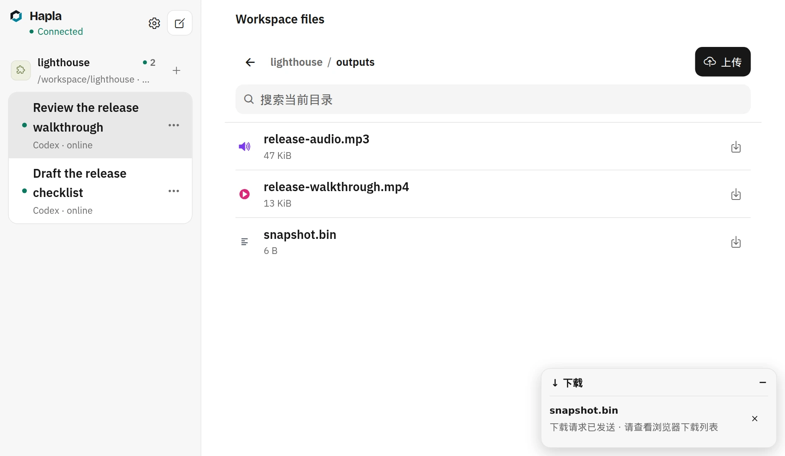
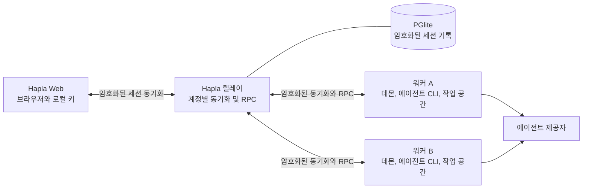

<div align="center">
  
  <h1>Hapla</h1>
  <p><strong>브라우저에서 Codex와 Claude Code를 실행하세요.</strong></p>
  <p>내 컴퓨터에서 실행되는 코딩 에이전트와 프로젝트 파일, 세션을 연결하는 자체 호스팅 작업 공간입니다.</p>
</div>

[English](../../README.md) · [简体中文](README.zh-CN.md) · [Français](README.fr.md) · [Deutsch](README.de.md) · [Español](README.es.md) · [日本語](README.ja.md) · **한국어** · [Русский](README.ru.md) · [العربية](README.ar.md) · [Português](README.pt.md)

[빠른 시작](#quick-start) · [Normal과 Coder 모드](#normal-and-coder-mode) · [일상적인 사용](#everyday-workflow) · [미디어와 다운로드](#media-and-downloads) · [워커 격리](#isolate-cli-workers) · [아키텍처](#architecture)

작업용 컴퓨터에서 코딩을 시작하고 휴대전화에서 같은 대화를 이어 가세요. 에이전트가 실행한 명령을 확인하고 프로젝트 파일을 둘러보거나 결과물을 재생하고 내려받을 수 있습니다. 에이전트는 연결된 컴퓨터에서 실행되며, Hapla는 직접 호스팅할 수 있는 릴레이를 통해 대화 기록을 동기화합니다.


*예제 프로젝트와 가상의 대화 데이터를 사용한 로컬 Hapla 환경입니다.*

<a name="quick-start"></a>

## 빠른 시작

**Node.js 22+**, **Git**, **Compose v2를 포함한 Docker**를 설치한 뒤 터미널에서 다음 명령을 실행합니다.

```bash
git clone https://github.com/trillionmonster/hapla.git
cd hapla
./deploy.sh up --non-interactive
```

스크립트가 Web 클라이언트와 릴레이를 빌드하고 서버 비밀 키를 생성한 뒤 상태 점검을 기다립니다. 브라우저 URL을 출력하며, 기본적으로 루프백에 바인딩하고 `12345`부터 빈 포트를 찾습니다. 다시 실행해도 배포 설정과 데이터베이스가 유지됩니다. 대화형 설정 마법사는 `./deploy.sh`로 열 수 있습니다. 다른 기기에서 접속하려면 접근할 수 있는 Web URL을 설정하고 원격 접속에 HTTPS를 사용하세요. [배포 옵션](../quickstart.md)

### 로그인하고 워커 연결하기

1. **Hapla를 엽니다.** **User key sign-in**을 선택하세요. 새 계정이라면 아래 명령으로 내 컴퓨터에서 고유한 키를 만들고 암호 관리자에 저장한 후 양식에 붙여넣습니다. 처음 로그인하면 이 릴레이에 계정이 생성됩니다. 다른 브라우저에서도 같은 키와 릴레이 URL을 사용합니다.
2. **CLI 워커를 페어링합니다.** 아래의 `hapla auth login`을 실행하고, 출력된 링크를 Hapla에 로그인한 브라우저에서 열어 연결을 승인합니다.
3. **워커에서 에이전트에 로그인합니다.** Codex 인증은 별도로 진행합니다. ChatGPT 계정이나 작업 공간 설정에서 기기 코드 인증을 켜고 브라우저에서 절차를 완료하세요. [Codex 인증](https://learn.chatgpt.com/docs/auth#login-on-headless-devices)
4. **워커를 시작합니다.** 머신이 **Machines**에 나타나면 해당 머신과 작업 디렉터리, 에이전트를 선택해 세션을 만듭니다.

```bash
# Hapla 계정당 한 번 실행하고 결과를 안전하게 보관합니다.
node <<'JS'
const { randomBytes } = require('node:crypto')
let key
do {
  key = randomBytes(32).toString('base64url')
} while (key.includes('-'))
console.log(key)
JS

# 저장소에서 실행합니다. 사용자마다 다른 워커 이름을 사용합니다.
./deploy.sh worker-add workstation
./deploy.sh worker-run workstation hapla auth login
./deploy.sh worker-run workstation codex login --device-auth
./deploy.sh worker-up workstation
```

<details>
<summary>Hapla 로그인 화면 보기</summary>


</details>

Docker 워커에는 Codex가 포함됩니다. Claude Code를 추가하려면 생성된 워커의 비공개 설정에 `HAPLA_CLAUDE_CODE_VERSION`을 지정하고 `worker-up`으로 다시 빌드한 뒤 `./deploy.sh worker-run workstation claude auth login`을 실행합니다. [Claude Code CLI 참고 문서](https://code.claude.com/docs/en/cli-reference)

**기존 로컬 저장소, 파일 또는 에이전트 로그인 상태**를 사용하려면 해당 컴퓨터에서 Hapla CLI를 실행하세요. `HAPLA_SERVER_URL`과 `HAPLA_WEBAPP_URL`을 배포 시 표시된 URL로 설정한 뒤, 의존성이 설치된 Hapla 소스 디렉터리에서 `pnpm cli auth login`과 `pnpm cli daemon start`를 실행합니다. [소스에서 CLI 실행하기](../../packages/hapla-cli/README.md) · [워커 설정](../environment-isolation.md)

### Codex 프롬프트 하나로 모두 시작하기

복제한 저장소에서 Codex를 열고 다음 프롬프트를 붙여넣습니다.

> 이 저장소에서 `demo`라는 격리된 로컬 Hapla 인스턴스를 설정해 줘. `./deploy.sh up --instance demo --non-interactive`를 실행하고 이어서 `./deploy.sh --instance demo worker-add workstation`을 실행해 줘.
> Web URL을 알려 주고 로그인, Hapla 워커 페어링, Codex 기기 인증을 안내해 줘. 키와 코드는 내가 직접 입력할게.
> 두 가지 로그인이 완료됐다고 확인하면 `./deploy.sh --instance demo worker-up workstation`을 실행하고 `./deploy.sh --instance demo status`로 확인해 줘. Web에서 머신이 온라인인지 확인하는 위치도 알려 줘. 모든 배포 명령은 `demo` 인스턴스에서 실행해 줘.

워커 페어링과 로그인을 한 번 마치면 명령 하나로 서비스와 워커를 시작할 수 있습니다. Codex에 실행을 요청해도 됩니다.

```bash
./deploy.sh up --instance demo --non-interactive && ./deploy.sh --instance demo worker-up workstation
```

<a name="normal-and-coder-mode"></a>

## Normal과 Coder 모드

두 화면은 같은 세션을 사용합니다. 도구 모음의 **`>_`** 버튼으로 Normal과 Coder를 전환할 수 있습니다. 화면 선택과 에이전트 권한은 별개입니다.

| | Normal | Coder |
| --- | --- | --- |
| 대화 | 지시, 답변, 첨부 파일과 결과 | 같은 대화와 자세한 도구 실행 내역 |
| 에이전트와 상호작용 | 질문, 승인 요청, 대화형 Skill | 같은 상호작용과 도구 입력 및 결과 |
| 작업 공간 | Web과 HTML 미리 보기 | 미리 보기, 파일 탐색기와 워커의 지속형 터미널 |
| 활용 | 지시를 보내거나 휴대전화에서 진행 상황 확인 | 명령과 파일을 조사하고 실행 결과 분석 |


<details>
<summary>브라우저 터미널의 테스트 실행 화면 보기</summary>


</details>

<details>
<summary>휴대전화 크기의 브라우저에서 같은 대화 보기</summary>


</details>

<a name="everyday-workflow"></a>

## 일상적인 사용

1. **New session**에서 연결된 머신, 프로젝트 디렉터리와 **Codex** 또는 **Claude Code**를 선택합니다. CLI가 지원하면 모델과 사고 깊이도 고를 수 있습니다.
2. 범위가 분명한 요청을 보냅니다. 예를 들어 *“만료된 초대를 거절하는 테스트를 추가해 줘. 초대 관련 테스트를 실행하고 결과를 요약해 줘.”*라고 요청할 수 있습니다.
3. Normal에서 답변을 읽습니다. Coder에서 테스트 명령을 확인하고 **Files**로 프로젝트를 살펴보거나 **Terminal**로 워커에 후속 명령을 실행합니다. **Preview**에서 로컬 웹 페이지나 HTML을 확인할 수 있습니다.
4. 작업을 이어가려면 같은 대화를 다시 엽니다. 지원되는 이미지, 영상, 오디오, PDF도 미리 볼 수 있습니다.

새 Docker 워커를 시험해 보려면 작업 공간에 공개 저장소를 복제합니다. **New session**에서 `/workspace/hapla`를 선택하고 *“릴레이와 Web UI는 어떻게 시작해? 명령과 상태 점검 방법을 보여 줘.”*라고 물어보세요.

```bash
./deploy.sh worker-run workstation git clone https://github.com/trillionmonster/hapla.git /workspace/hapla
```

대화에 UI가 포함된 Skill도 실행할 수 있습니다. **Character composer**는 Codex Skill과 MCP 앱을 조합해 참조 이미지를 고른 뒤 확정한 선택을 에이전트의 다음 턴으로 전달합니다. [실행 가능한 Character composer 예제](../../examples/interactive-skills/character-composer/README.md) · [대화형 Skill](../interactive-skills.md)

### 기본 모델 설정하기

**Settings → New session defaults**를 엽니다. **Codex**나 **Claude Code**를 고르고 **Model**, **Thinking depth**, **Permissions**를 설정합니다. Codex는 모델의 지원 범위에 따라 응답 속도도 설정할 수 있습니다. **Environment default**는 기본 모델 선택을 CLI에 맡깁니다. 모델 목록은 연결된 머신에서 제공하며, 기본값은 세션마다 바꿀 수 있습니다.


### CLI 업데이트하기

- **Hapla에서 사용하는 Codex.** **Machines → 대상 머신 → Codex CLI**에서 **Update CLI**(`更新 CLI`)를 선택합니다. 해당 머신에 관리 버전을 설치하고 모델 목록을 갱신합니다. 실행 중인 프로세스는 기존 버전을 유지하고 새 프로세스부터 업데이트한 버전을 사용합니다. 모델 목록만 동기화하려면 **Refresh models and effort levels**(`刷新模型与档位`)를 선택합니다. Web 설치는 Linux와 macOS에서 지원합니다. Windows에서는 패키지 관리자를 사용하세요. [Codex CLI 업데이트](../codex-cli-update.md)
- **소스에서 빌드한 Hapla CLI.** 저장소에서 `git pull --ff-only`와 `pnpm install --frozen-lockfile`을 실행합니다. 빌드한 CLI를 사용한다면 `pnpm --filter ./packages/hapla-cli build`를 실행하고 적절한 시점에 데몬을 재시작합니다. Docker 워커는 변경 사항을 받은 뒤 해당 워커의 `worker-up`을 다시 실행합니다. [CLI 명령](../../packages/hapla-cli/README.md)

### 세션 이어 가기

Web에서 같은 대화를 열고 다음 메시지를 보냅니다. 브라우저를 닫아도 워커는 계속 실행됩니다. **Sleep**은 대화 기록을 보존하면서 에이전트 프로세스를 해제합니다. 휴면 중인 대화를 열면 Hapla가 기존 온라인 워커에 저장된 Codex 스레드나 Claude Code 세션의 재개를 요청합니다. 워커가 오프라인이어도 기록을 읽을 수 있으며, 다시 시작하면 작업을 이어 갈 수 있습니다.

대화 URL에 있는 Hapla 세션 ID로 원래 워커에서 직접 재개할 수도 있습니다.

```bash
hapla resume <hapla-session-id>
# Hapla 소스 저장소에서 실행합니다.
pnpm cli resume <hapla-session-id>
```

[세션 수명 주기 및 복구](../session-lifecycle.md)

**음성 입력은 현재 지원하지 않습니다.** 마이크 입력, 브라우저 권한, 음성 전사, 명확한 오디오 처리 제어 기능을 함께 개발하고 테스트할 기여자를 환영합니다. [기여하기](../../CONTRIBUTING.md)

<a name="media-and-downloads"></a>

## 미디어와 다운로드

- **생성한 결과물.** Hapla는 완료된 단계 옆에 결과물을 모읍니다. 생성된 이미지는 자동으로 업로드됩니다. 작업 공간의 영상과 오디오는 파일을 참조하고 필요할 때 원본을 엽니다. 파일 카드로 결과를 확인하거나 결과물 모음을 펼쳐 중간 파일을 볼 수 있습니다.
- **미리 보기와 다운로드.** **Coder → Files**에서 워커의 작업 공간을 둘러볼 수 있습니다. 지원되는 영상과 오디오 재생, 이미지와 PDF 미리 보기가 가능합니다. 워커가 작업 공간에서 접근할 수 있는 파일은 배포 환경의 전송 한도 내에서 형식과 관계없이 원본을 내려받을 수 있습니다. 호환 코덱은 재생에만 필요합니다.
- **대용량 파일 전송.** 릴레이의 대역폭과 비용을 줄이려면 비공개 Cloudflare R2 기반 파일 서비스에 연결하세요. 브라우저는 임시 서명 URL로 대용량 원본을 R2에서 직접 받을 수 있습니다. R2 직접 송신에는 대역폭 요금이 없으며 스토리지와 작업에는 요금이 발생할 수 있습니다. 선택 사항인 실험용 다운로드 Worker는 기존 R2 서명 URL의 데이터를 스트리밍합니다. 실제 속도는 배포 환경과 클라이언트 네트워크에 따라 달라집니다. [Cloudflare 설정](../cloudflare.md) · [R2 요금](https://developers.cloudflare.com/r2/pricing/)


<details>
<summary>파일 탐색기와 오디오 플레이어 보기</summary>




</details>

미디어를 검토할 때는 결과 요약과 최종 영상 또는 오디오 링크를 에이전트에게 요청합니다. 링크에서 미리 보거나 **Files**에서 원본을 다운로드하세요.

기존의 호환 R2 파일 서비스는 배포 마법사에서 활성화하거나 URL을 명시해 연결합니다.

```bash
./deploy.sh up --file-service https://files.example.com --non-interactive
```

다운로드와 재생 위치 이동에 HTTP Range를 사용할 수 있도록 비공개 버킷의 CORS에 Hapla Web 클라이언트의 정확한 오리진을 설정합니다. R2 자격 증명은 파일 서비스에서 관리합니다. 로컬 전송에는 인증된 동일 오리진 파일 경로를 사용합니다. [비공개 버킷 CORS](../cloudflare.md#private-bucket-cors) · [로컬 파일 전송](../lan-file-delivery.md) · [결과물 모음](../artifact-collections.md)

<a name="architecture"></a>

## 아키텍처



- **브라우저.** 세션을 복호화해 표시하고 지시를 전송하며 작업 공간 도구를 엽니다. 워커 연결이 끊겨도 페어링된 브라우저에서 저장된 기록을 읽을 수 있습니다.
- **릴레이.** 계정을 인증하고 암호화된 세션 데이터를 내장 PGlite에 보존하며 적절한 워커로 실시간 업데이트와 RPC를 전달합니다.
- **CLI 워커.** 머신 기능을 알리고 자체 자격 증명으로 Codex나 Claude Code를 실행하며 터미널 및 작업 공간 요청을 처리합니다. 코드 실행과 에이전트 제공자 접속은 워커에서 이루어집니다.

### 암호화와 데이터 경계

| 용도 | 알고리즘 |
| --- | --- |
| 레코드별 키를 사용하는 세션 데이터 | AES-256-GCM |
| 이전 형식의 세션 데이터 | NaCl secretbox의 XSalsa20-Poly1305 |
| 페어링과 콘텐츠 키 래핑 | X25519 키 합의와 NaCl box의 XSalsa20-Poly1305 |
| 사용자 키 인증 | Ed25519 챌린지 서명 |

페어링된 클라이언트가 콘텐츠 키를 보유합니다. 릴레이는 계정과 세션 ID, 시퀀스 번호, 타임스탬프 같은 운영 메타데이터를 볼 수 있습니다. 첨부와 원본은 인증된 파일 전송 경로를 따르며 설정된 파일 서비스가 파일의 바이트를 처리할 수 있습니다. 에이전트 제공자는 CLI가 보낸 지시와 컨텍스트를 받습니다. 원격 배포에는 HTTPS를 사용하세요. [개인정보 및 데이터 처리](../../PRIVACY.md) · [배포](../deployment.md)

<a name="isolate-cli-workers"></a>

### CLI 워커 격리하기

사용자마다 Web 계정과 워커를 따로 만듭니다. 같은 Web 클라이언트와 릴레이를 공유하면서 프로젝트 파일과 로그인 상태는 별도의 볼륨에 저장할 수 있습니다. 다음 예제는 `team` 인스턴스에 워커 2개를 설정합니다.

```bash
./deploy.sh up --instance team --non-interactive

# 사용자마다 자신의 Web 및 Codex 계정을 사용합니다.
for name in account-a account-b; do
  ./deploy.sh --instance team worker-add "$name" || break
  ./deploy.sh --instance team worker-run "$name" hapla auth login || break
  ./deploy.sh --instance team worker-run "$name" codex login --device-auth || break
  ./deploy.sh --instance team worker-up "$name" || break
done
```

워커는 독립적인 Compose 프로젝트, `/workspace` 볼륨, `.hapla`, `.codex`, `.claude`를 위한 홈 볼륨을 갖습니다. root 권한 없이 실행되며 Docker 소켓을 마운트하지 않고 릴레이 네트워크에 참가합니다. 릴레이, 포트, 서버 키, 데이터베이스도 분리하려면 서로 다른 `--instance` 이름을 사용하세요. 서로 신뢰하지 않는 사용자는 호스트 커널을 공유하는 대신 독립 호스트나 VM으로 격리할 수 있습니다. [환경 격리](../environment-isolation.md)

## 기여하기

`corepack enable`과 `pnpm install --frozen-lockfile`로 개발 의존성을 준비하고 `pnpm build`를 실행합니다. 저장소에는 [Web 클라이언트](../../packages/hapla-web), [CLI](../../packages/hapla-cli), [릴레이](../../packages/hapla-server), [공유 프로토콜](../../packages/hapla-wire)이 있습니다. `deploy/`에는 배포 템플릿과 선택 사항인 Cloudflare 파일 전송 설정이 있습니다. 기본 배포는 Docker Compose와 내장 PGlite를 사용합니다. [개발](../development.md) · [테스트](../testing.md) · [저장소 구조](../repository-layout.md)

[문서 모음](../README.md) · [설정](../configuration.md) · [Cloudflare](../cloudflare.md) · [유지보수 Skill](../../.agents/skills/hapla-maintenance/SKILL.md)

이슈와 풀 리퀘스트를 환영합니다. 기여 가이드와 행동 강령을 따르고 취약점은 보안 정책에 따라 신고해 주세요. [기여 가이드](../../CONTRIBUTING.md) · [행동 강령](../../CODE_OF_CONDUCT.md) · [보안 정책](../../SECURITY.md)

## 라이선스와 감사의 말

Hapla는 **MIT 라이선스**로 공개됩니다. **slopus/happy**의 초기 구현을 기반으로 하며 원본 MIT 라이선스와 저작권 고지를 유지합니다. 작업을 공개한 Slopus와 Happy 기여자들에게 감사드립니다. [MIT 라이선스](../../LICENSE) · [원본 Happy 프로젝트](https://github.com/slopus/happy)
