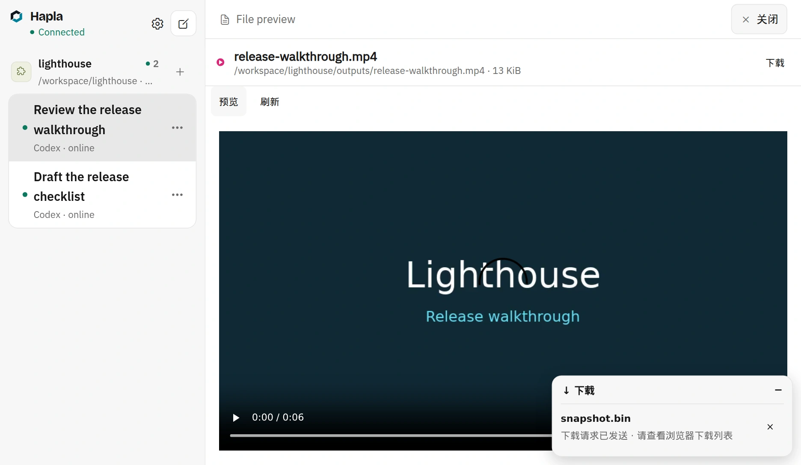
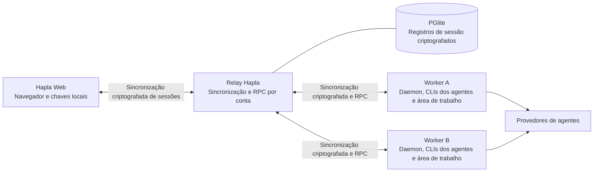

<div align="center">
  
  <h1>Hapla</h1>
  <p><strong>Execute Codex e Claude Code no navegador.</strong></p>
  <p>Um ambiente de trabalho que você hospeda para seus agentes de programação, arquivos e sessões nas suas próprias máquinas.</p>
</div>

[English](../../README.md) · [简体中文](README.zh-CN.md) · [Français](README.fr.md) · [Deutsch](README.de.md) · [Español](README.es.md) · [日本語](README.ja.md) · [한국어](README.ko.md) · [Русский](README.ru.md) · [العربية](README.ar.md) · **Português**

[Início rápido](#quick-start) · [Modos Normal e Coder](#normal-and-coder-mode) · [Uso diário](#everyday-workflow) · [Mídia e downloads](#media-and-downloads) · [Isolamento de workers](#isolate-cli-workers) · [Arquitetura](#architecture)

Comece a programar no computador e retome a mesma conversa no celular. Pelo navegador, você pode inspecionar os comandos do agente, navegar pelos arquivos do projeto e reproduzir ou baixar os resultados. O agente roda em uma máquina pareada. O Hapla sincroniza o histórico por meio de um relay que você pode hospedar.


*Hapla rodando localmente com um projeto de exemplo e dados de conversa fictícios.*

<a name="quick-start"></a>

## Início rápido

Instale **Node.js 22+**, **Git** e **Docker com Compose v2** e execute estes comandos no terminal.

```bash
git clone https://github.com/trillionmonster/hapla.git
cd hapla
./deploy.sh up --non-interactive
```

O script compila o cliente web e o relay, gera uma chave privada para o servidor e aguarda a verificação de integridade. Ele informa a URL para abrir no navegador. Por padrão, escuta na interface de loopback e procura uma porta livre a partir de `12345`. As próximas execuções preservam a configuração e o banco de dados. Use `./deploy.sh` para abrir o assistente interativo. Para acessar de outro dispositivo, configure uma URL acessível e use HTTPS para acesso remoto. [Opções de implantação](../quickstart.md)

### Entrar e conectar um worker

1. **Abra o Hapla.** Selecione **User key sign-in**. Para criar uma conta, gere uma chave exclusiva na sua máquina com o comando abaixo, guarde-a em um gerenciador de senhas e cole-a no formulário. O primeiro login cria a conta nesse relay. Para entrar em outro navegador, use a mesma chave e a mesma URL do relay.
2. **Pareie um worker de CLI.** Execute `hapla auth login` como indicado abaixo, abra o link exibido no navegador em que você já entrou e aprove a conexão.
3. **Entre na conta do agente no worker.** O Codex tem autenticação própria. Ative o login por código de dispositivo nas configurações da conta ou área de trabalho do ChatGPT e conclua o fluxo no navegador. [Autenticação do Codex](https://learn.chatgpt.com/docs/auth#login-on-headless-devices)
4. **Inicie o worker.** Quando a máquina aparecer em **Machines**, crie uma sessão com essa máquina, uma pasta de trabalho e um agente.

```bash
# Uma vez por conta Hapla. Guarde o resultado em local seguro.
node <<'JS'
const { randomBytes } = require('node:crypto')
let key
do {
  key = randomBytes(32).toString('base64url')
} while (key.includes('-'))
console.log(key)
JS

# Execute no repositório. Use um nome de worker diferente para cada usuário.
./deploy.sh worker-add workstation
./deploy.sh worker-run workstation hapla auth login
./deploy.sh worker-run workstation codex login --device-auth
./deploy.sh worker-up workstation
```

<details>
<summary>Ver a tela de login do Hapla</summary>


</details>

O worker Docker inclui o Codex. Para adicionar o Claude Code, defina `HAPLA_CLAUDE_CODE_VERSION` na configuração privada gerada, reconstrua com `worker-up` e execute `./deploy.sh worker-run workstation claude auth login`. [Referência da CLI do Claude Code](https://code.claude.com/docs/en/cli-reference)

Para usar **um repositório, arquivos ou login do agente já existentes** em uma máquina, execute a CLI Hapla nela. Defina `HAPLA_SERVER_URL` e `HAPLA_WEBAPP_URL` com a URL exibida na implantação. No repositório Hapla com as dependências instaladas, execute `pnpm cli auth login` e `pnpm cli daemon start`. [CLI a partir do código-fonte](../../packages/hapla-cli/README.md) · [Configuração de workers](../environment-isolation.md)

### Iniciar tudo com um prompt no Codex

Abra o Codex no repositório clonado e cole este prompt.

> Configure o Hapla a partir deste repositório em uma instância local isolada chamada `demo`. Execute `./deploy.sh up --instance demo --non-interactive` e depois `./deploy.sh --instance demo worker-add workstation`.
> Informe a URL da interface web e me oriente sobre login, pareamento do Hapla e autorização de dispositivo no Codex. Eu mesmo informarei minhas chaves e códigos.
> Quando eu confirmar os dois logins, execute `./deploy.sh --instance demo worker-up workstation` e confira `./deploy.sh --instance demo status`. Mostre onde confirmar na interface web que a máquina está online. Use a instância `demo` em todos os comandos de implantação.

Após o primeiro pareamento e login, este comando inicia o conjunto de serviços e o worker. Você também pode pedir ao Codex que o execute.

```bash
./deploy.sh up --instance demo --non-interactive && ./deploy.sh --instance demo worker-up workstation
```

<a name="normal-and-coder-mode"></a>

## Modos Normal e Coder

Os dois modos usam a mesma sessão. Selecione **`>_`** na barra de ferramentas para alternar entre eles. O modo de exibição é independente das permissões do agente.

| | Normal | Coder |
| --- | --- | --- |
| Conversa | Prompts, respostas, anexos e resultados | A mesma conversa com a atividade detalhada das ferramentas |
| Interação | Perguntas, pedidos de aprovação e Skills interativos | As mesmas interações com as entradas e saídas das ferramentas |
| Área de trabalho | Prévia de páginas web e HTML | Prévia, explorador de arquivos e terminal persistente no worker |
| Uso | Dar instruções e acompanhar o progresso, inclusive no celular | Inspecionar comandos, navegar por arquivos e diagnosticar resultados |


<details>
<summary>Ver os testes no terminal do navegador</summary>


</details>

<details>
<summary>Ver a mesma conversa em um navegador do tamanho de um celular</summary>


</details>

<a name="everyday-workflow"></a>

## Uso diário

1. Em **New session**, escolha a máquina pareada, a pasta do projeto e **Codex** ou **Claude Code**. Escolha o modelo e o nível de raciocínio quando a CLI oferecer essas opções.
2. Envie uma tarefa com escopo definido. Por exemplo, *“Adicione um teste que rejeite convites expirados. Execute os testes de convites e resuma o resultado.”*
3. Leia a resposta no modo Normal. Mude para Coder para inspecionar o comando, abra **Files** para navegar pelo projeto ou use **Terminal** para executar outro comando no worker. **Preview** mostra uma página web local ou HTML.
4. Reabra a mesma conversa para continuar o trabalho. O Hapla também exibe imagens, vídeos, áudios e PDFs compatíveis.

Para testar um worker Docker novo, clone um repositório público na área de trabalho. Escolha `/workspace/hapla` em **New session** e pergunte *“Como inicializar o relay e a interface web? Mostre os comandos e como verificar se estão funcionando.”*

```bash
./deploy.sh worker-run workstation git clone https://github.com/trillionmonster/hapla.git /workspace/hapla
```

Experimente um Skill com interface na conversa. O exemplo **Character composer** associa um Skill do Codex a um aplicativo MCP para selecionar imagens de referência e envia a seleção confirmada para o próximo turno. [Exemplo executável do Character composer](../../examples/interactive-skills/character-composer/README.md) · [Skills interativos](../interactive-skills.md)

### Definir o modelo padrão

Abra **Settings → New session defaults**. Escolha **Codex** ou **Claude Code** e configure **Model**, **Thinking depth** e **Permissions**. O Codex também permite escolher a velocidade de resposta conforme os recursos do modelo. **Environment default** deixa a escolha do modelo para a CLI. O catálogo vem de uma máquina pareada e você pode alterar os valores padrão em cada sessão.


### Atualizar a CLI

- **Codex usado pelo Hapla.** Abra **Machines → sua máquina → Codex CLI** e selecione **Update CLI** (`更新 CLI`). O Hapla instala a versão gerenciada nessa máquina e atualiza o catálogo. Processos ativos mantêm a versão em uso e os novos usam a versão atualizada. **Refresh models and effort levels** (`刷新模型与档位`) atualiza apenas o catálogo. O instalador web funciona no Linux e no macOS. No Windows, use o gerenciador de pacotes. [Atualizações da CLI do Codex](../codex-cli-update.md)
- **CLI Hapla compilada a partir do código-fonte.** Execute `git pull --ff-only` e `pnpm install --frozen-lockfile` no repositório. Se usa a CLI compilada, execute também `pnpm --filter ./packages/hapla-cli build`. Reinicie o daemon quando for conveniente. Para um worker Docker, execute `worker-up` de novo para esse worker após atualizar o repositório. [Comandos da CLI](../../packages/hapla-cli/README.md)

### Retomar uma sessão

Reabra a conversa na web e envie a próxima mensagem. O worker continua rodando ao fechar o navegador. **Sleep** libera o processo do agente e preserva o histórico. Ao abrir uma conversa suspensa, o Hapla solicita ao worker original, se estiver online, que retome o thread do Codex ou a sessão do Claude Code. O histórico continua disponível se o worker estiver offline. Inicie-o novamente para continuar.

No worker original, você também pode usar o ID da sessão Hapla que aparece na URL da conversa.

```bash
hapla resume <hapla-session-id>
# No repositório de código-fonte do Hapla.
pnpm cli resume <hapla-session-id>
```

[Ciclo de vida e recuperação de sessões](../session-lifecycle.md)

**A entrada de voz ainda não está disponível.** Convidamos quem quiser desenvolver e testar a entrada por microfone, as permissões do navegador, a transcrição e controles claros para o processamento de áudio. [Como contribuir](../../CONTRIBUTING.md)

<a name="media-and-downloads"></a>

## Mídia e downloads

- **Resultados gerados.** O Hapla organiza os artefatos junto das etapas concluídas na conversa. As imagens geradas são enviadas automaticamente. Os áudios e vídeos da área de trabalho são referenciados e os originais são abertos sob demanda. Abra um cartão para conferir o resultado ou expanda uma coleção para ver arquivos intermediários.
- **Prévia e download.** Abra **Coder → Files** para navegar pela área de trabalho. Reproduza vídeo e áudio compatíveis, visualize imagens e PDFs ou baixe os originais de qualquer formato que o worker possa acessar na área de trabalho, respeitando os limites de transferência da implantação. Um codec compatível só é necessário para a reprodução.
- **Arquivos grandes.** Conecte um serviço de arquivos com um bucket privado do Cloudflare R2 para reduzir o uso da conexão do relay. URLs assinadas temporárias permitem que o navegador baixe os originais grandes diretamente do R2. A saída direta do R2 tem custo zero de largura de banda. Armazenamento e operações podem ser cobrados. Um Worker de download experimental e opcional pode transmitir o conteúdo de URLs assinadas existentes do R2. A taxa de transferência depende da implantação e da rede do cliente. [Configuração do Cloudflare](../cloudflare.md) · [Preços do R2](https://developers.cloudflare.com/r2/pricing/)



<details>
<summary>Ver o explorador de arquivos e o player de áudio</summary>


</details>

Ao revisar mídia, peça ao agente para resumir o resultado e fornecer um link para o vídeo ou áudio final. Abra o link para visualizar ou baixe o original em **Files**.

Habilite um serviço compatível de R2 já existente no assistente de implantação ou informe a URL do serviço no comando.

```bash
./deploy.sh up --file-service https://files.example.com --non-interactive
```

Configure o CORS do bucket privado com a origem exata do cliente web Hapla. Assim, downloads e mudanças de posição na mídia podem usar requisições HTTP Range. Mantenha as credenciais do R2 no serviço de arquivos. Para entrega local, use a rota de arquivos autenticada de mesma origem. [CORS para bucket privado](../cloudflare.md#private-bucket-cors) · [Entrega local de arquivos](../lan-file-delivery.md) · [Coleções de artefatos](../artifact-collections.md)

<a name="architecture"></a>

## Arquitetura



- **Navegador.** Descriptografa e exibe sessões, envia prompts e abre as ferramentas. O navegador pareado pode ler o histórico armazenado mesmo com o worker desconectado.
- **Relay.** Autentica contas, guarda sessões criptografadas no PGlite incorporado e encaminha atualizações e RPC para o worker certo.
- **Worker de CLI.** Publica os recursos da máquina, executa Codex ou Claude Code com credenciais próprias e atende solicitações de terminal e da área de trabalho. O worker executa o código e acessa o provedor do agente.

### Criptografia e limites de acesso aos dados

| Finalidade | Algoritmo |
| --- | --- |
| Dados de sessão com chaves por registro | AES-256-GCM |
| Dados de sessão em formato legado | XSalsa20-Poly1305 via NaCl secretbox |
| Pareamento e encapsulamento de chaves de conteúdo | Acordo de chaves X25519 com XSalsa20-Poly1305 via NaCl box |
| Autenticação com chave de usuário | Assinatura de desafio com Ed25519 |

Os clientes pareados mantêm as chaves de conteúdo. O relay vê metadados de operação, como IDs de conta e de sessão, números de sequência e carimbos de tempo. Anexos e originais seguem uma rota autenticada. Os serviços de arquivos configurados podem processar seus bytes. Os provedores de agentes recebem os prompts e o contexto que a CLI transmite. Use HTTPS em instalações remotas. [Privacidade e tratamento de dados](../../PRIVACY.md) · [Implantação](../deployment.md)

<a name="isolate-cli-workers"></a>

### Isolar workers de CLI

Use uma conta web e um worker separados por pessoa. Os workers podem compartilhar a implantação web e o relay, com volumes próprios para arquivos de projeto e logins. Este exemplo configura dois workers na instância `team`.

```bash
./deploy.sh up --instance team --non-interactive

# Cada usuário entra com suas próprias contas da web e do Codex.
for name in account-a account-b; do
  ./deploy.sh --instance team worker-add "$name" || break
  ./deploy.sh --instance team worker-run "$name" hapla auth login || break
  ./deploy.sh --instance team worker-run "$name" codex login --device-auth || break
  ./deploy.sh --instance team worker-up "$name" || break
done
```

Cada worker tem um projeto Compose, um volume `/workspace` e um volume de usuário para `.hapla`, `.codex` e `.claude`. Ele roda sem privilégios de root e entra na rede do relay sem montar o socket do Docker. Use nomes `--instance` distintos para separar relays, portas, chaves de servidor e bancos de dados. Quando não há confiança entre os usuários, hosts ou máquinas virtuais separados oferecem uma barreira mais forte que um kernel compartilhado. [Isolamento de ambientes](../environment-isolation.md)

## Como contribuir

Prepare as dependências com `corepack enable` e `pnpm install --frozen-lockfile`, depois execute `pnpm build`. O repositório contém o [cliente web](../../packages/hapla-web), a [CLI](../../packages/hapla-cli), o [relay](../../packages/hapla-server) e o [protocolo compartilhado](../../packages/hapla-wire). Os modelos de implantação e a integração opcional com o Cloudflare ficam em `deploy/`. A implantação padrão usa Docker Compose e PGlite incorporado. [Desenvolvimento](../development.md) · [Testes](../testing.md) · [Estrutura do repositório](../repository-layout.md)

[Índice da documentação](../README.md) · [Configuração](../configuration.md) · [Cloudflare](../cloudflare.md) · [Skill de manutenção](../../.agents/skills/hapla-maintenance/SKILL.md)

Issues e pull requests são bem-vindas. Siga o guia de contribuição e o código de conduta. Use a política de segurança para reportar vulnerabilidades. [Guia de contribuição](../../CONTRIBUTING.md) · [Código de conduta](../../CODE_OF_CONDUCT.md) · [Política de segurança](../../SECURITY.md)

## Licença e agradecimentos

O Hapla é um projeto de código aberto sob a **licença MIT**. Baseia-se na implementação original de **slopus/happy** e preserva a licença MIT e o aviso de direitos autorais do projeto original. Obrigado a Slopus e às pessoas que contribuíram com o Happy por disponibilizarem esse trabalho. [Licença MIT](../../LICENSE) · [Projeto Happy original](https://github.com/slopus/happy)
