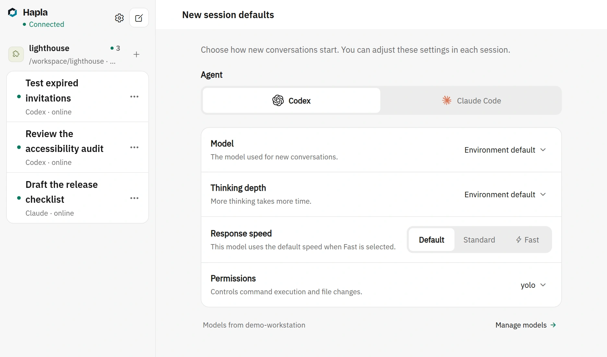
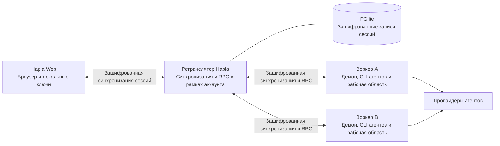

<div align="center">
  
  <h1>Hapla</h1>
  <p><strong>Запускайте Codex и Claude Code из браузера.</strong></p>
  <p>Рабочая среда для агентов программирования, файлов проектов и сессий на ваших машинах. Её можно разместить на собственном сервере.</p>
</div>

[English](../../README.md) · [简体中文](README.zh-CN.md) · [Français](README.fr.md) · [Deutsch](README.de.md) · [Español](README.es.md) · [日本語](README.ja.md) · [한국어](README.ko.md) · **Русский** · [العربية](README.ar.md) · [Português](README.pt.md)

[Быстрый старт](#quick-start) · [Режимы Normal и Coder](#normal-and-coder-mode) · [Повседневная работа](#everyday-workflow) · [Медиа и загрузки](#media-and-downloads) · [Изоляция воркеров](#isolate-cli-workers) · [Архитектура](#architecture)

Начните работу на компьютере и продолжите тот же диалог на телефоне. В браузере можно проверить команды агента, просмотреть файлы проекта, воспроизвести или скачать результаты. Агент работает на привязанной машине. Hapla синхронизирует историю через ретранслятор, который можно развернуть самостоятельно.


*Локальный экземпляр Hapla с демонстрационным проектом и вымышленными данными диалога.*

<a name="quick-start"></a>

## Быстрый старт

Установите **Node.js 22+**, **Git** и **Docker с Compose v2**, затем выполните команды в терминале.

```bash
git clone https://github.com/trillionmonster/hapla.git
cd hapla
./deploy.sh up --non-interactive
```

Скрипт собирает веб-клиент и ретранслятор, создаёт закрытый ключ сервера и ждёт успешной проверки работоспособности. Он выводит URL для браузера. По умолчанию используется интерфейс loopback, а поиск свободного порта начинается с `12345`. Повторный запуск сохраняет конфигурацию и базу данных. `./deploy.sh` открывает мастер настройки. Для доступа с телефона или другой машины укажите доступный веб-адрес и настройте HTTPS для удалённых подключений. [Варианты развёртывания](../quickstart.md)

### Вход и подключение воркера

1. **Откройте Hapla.** Выберите **User key sign-in**. Для нового аккаунта создайте уникальный ключ на своём компьютере командой ниже, сохраните его в менеджере паролей и вставьте в форму. При первом входе на этом ретрансляторе создаётся аккаунт. В другом браузере используйте тот же ключ и URL ретранслятора.
2. **Привяжите CLI-воркер.** Запустите `hapla auth login` по примеру ниже. Откройте выведенную ссылку в браузере, где вы уже вошли в Hapla, и подтвердите подключение.
3. **Войдите в аккаунт агента на воркере.** Codex требует отдельной авторизации. Включите вход по коду устройства в настройках аккаунта или рабочей области ChatGPT и завершите авторизацию в браузере. [Аутентификация Codex](https://learn.chatgpt.com/docs/auth#login-on-headless-devices)
4. **Запустите воркер.** Когда машина появится в разделе **Machines**, создайте сессию и выберите эту машину, рабочий каталог и агента.

```bash
# Один раз на аккаунт Hapla. Храните результат в секрете.
node <<'JS'
const { randomBytes } = require('node:crypto')
let key
do {
  key = randomBytes(32).toString('base64url')
} while (key.includes('-'))
console.log(key)
JS

# Запускайте из репозитория. Дайте каждому воркеру отдельное имя.
./deploy.sh worker-add workstation
./deploy.sh worker-run workstation hapla auth login
./deploy.sh worker-run workstation codex login --device-auth
./deploy.sh worker-up workstation
```

<details>
<summary>Посмотреть экран входа Hapla</summary>


</details>

Docker-воркер включает Codex. Чтобы добавить Claude Code, задайте `HAPLA_CLAUDE_CODE_VERSION` в созданной приватной конфигурации воркера, пересоберите его командой `worker-up` и выполните `./deploy.sh worker-run workstation claude auth login`. [Справочник Claude Code CLI](https://code.claude.com/docs/en/cli-reference)

Чтобы использовать **уже имеющийся локальный репозиторий, файлы или авторизацию агента**, запустите Hapla CLI на этой машине. Присвойте `HAPLA_SERVER_URL` и `HAPLA_WEBAPP_URL` URL, выведенный при развёртывании. Выполните `pnpm cli auth login` и `pnpm cli daemon start` из репозитория Hapla с установленными зависимостями. [CLI из исходного кода](../../packages/hapla-cli/README.md) · [Настройка воркеров](../environment-isolation.md)

### Запуск всего окружения одним запросом к Codex

Откройте Codex в клонированном репозитории и вставьте этот запрос.

> Разверни Hapla из этого репозитория в изолированном локальном экземпляре `demo`. Выполни `./deploy.sh up --instance demo --non-interactive`, затем `./deploy.sh --instance demo worker-add workstation`.
> Сообщи веб-адрес и объясни, как войти в Hapla, привязать воркер и авторизовать устройство в Codex. Ключи и коды я введу сам.
> Когда я подтвержу оба входа, выполни `./deploy.sh --instance demo worker-up workstation` и проверь `./deploy.sh --instance demo status`. Покажи, где в веб-интерфейсе проверить, что машина в сети. Во всех командах развёртывания используй экземпляр `demo`.

После первой привязки и авторизации запустите весь стек и воркер одной командой или попросите Codex выполнить её.

```bash
./deploy.sh up --instance demo --non-interactive && ./deploy.sh --instance demo worker-up workstation
```

<a name="normal-and-coder-mode"></a>

## Режимы Normal и Coder

Оба режима открывают одну сессию. Переключайтесь кнопкой **`>_`** на панели инструментов. Режим отображения выбирается независимо от разрешений агента.

| | Normal | Coder |
| --- | --- | --- |
| Диалог | Запросы, ответы, вложения и результаты | Тот же диалог с подробностями работы инструментов |
| Взаимодействие | Вопросы, запросы на подтверждение и интерактивные Skills | Те же действия, а также входные данные и результаты инструментов |
| Рабочая область | Предпросмотр веб-страниц и HTML | Предпросмотр, файловый браузер и сохраняющий состояние терминал на воркере |
| Когда использовать | Поставить задачу и проверить прогресс, в том числе с телефона | Проверить команды, просмотреть файлы и разобраться в результатах |


<details>
<summary>Посмотреть тесты в терминале браузера</summary>


</details>

<details>
<summary>Посмотреть тот же диалог в браузере на экране телефона</summary>


</details>

<a name="everyday-workflow"></a>

## Повседневная работа

1. В **New session** выберите привязанную машину, каталог проекта и **Codex** или **Claude Code**. Если CLI поддерживает модель и уровень рассуждения, выберите их.
2. Отправьте конкретную задачу. Например, *«Добавь тест, который отклоняет просроченные приглашения. Запусти тесты приглашений и подведи итог.»*
3. Прочитайте ответ в режиме Normal. В Coder можно проверить команду, открыть **Files** для просмотра проекта и запустить следующую команду через **Terminal**. **Preview** показывает локальную веб-страницу или HTML.
4. Чтобы продолжить работу, снова откройте тот же диалог. В Hapla также можно просматривать изображения, видео, аудио и PDF поддерживаемых форматов.

Для пробы клонируйте общедоступный репозиторий в рабочую область нового Docker-воркера. В **New session** выберите `/workspace/hapla` и спросите *«Как запустить ретранслятор и веб-интерфейс? Покажи команды и проверку работоспособности.»*

```bash
./deploy.sh worker-run workstation git clone https://github.com/trillionmonster/hapla.git /workspace/hapla
```

Попробуйте Skill с интерфейсом прямо в диалоге. В примере **Character composer** Codex Skill и приложение MCP позволяют выбрать изображения-референсы, а подтверждённый выбор передаётся агенту на следующем шаге. [Исполняемый пример Character composer](../../examples/interactive-skills/character-composer/README.md) · [Интерактивные Skills](../interactive-skills.md)

### Модель по умолчанию

Откройте **Settings → New session defaults**. Выберите **Codex** или **Claude Code**, затем настройте **Model**, **Thinking depth** и **Permissions**. Codex также позволяет выбрать скорость ответа в зависимости от возможностей модели. **Environment default** передаёт выбор модели в CLI. Список моделей приходит с привязанной машины. Настройки можно изменить для отдельной сессии.



### Обновление CLI

- **Codex в Hapla.** Откройте **Machines → нужная машина → Codex CLI** и выберите **Update CLI** (`更新 CLI`). Hapla установит управляемую версию на этой машине и обновит каталог моделей. Текущие процессы сохранят свои версии, а новые будут использовать обновление. **Refresh models and effort levels** (`刷新模型与档位`) обновляет только каталог. Веб-установка работает в Linux и macOS. Для Windows используйте менеджер пакетов. [Обновление Codex CLI](../codex-cli-update.md)
- **Hapla CLI, собранный из исходников.** Выполните `git pull --ff-only` и `pnpm install --frozen-lockfile` в репозитории. Если вы используете собранный CLI, выполните `pnpm --filter ./packages/hapla-cli build`. Перезапустите демон в подходящий момент. Для Docker-воркера после обновления репозитория повторите `worker-up` для этого воркера. [Команды CLI](../../packages/hapla-cli/README.md)

### Продолжение сессии

Откройте тот же диалог в браузере и отправьте следующее сообщение. После закрытия браузера воркер продолжает работу. **Sleep** освобождает процесс агента и сохраняет историю. При открытии приостановленного диалога Hapla просит исходный воркер, если он в сети, возобновить сохранённый поток Codex или сессию Claude Code. История доступна и при отключённом воркере. Чтобы продолжить, запустите его снова.

На исходном воркере можно также использовать идентификатор сессии Hapla из URL диалога.

```bash
hapla resume <hapla-session-id>
# Из репозитория исходного кода Hapla.
pnpm cli resume <hapla-session-id>
```

[Жизненный цикл и восстановление сессий](../session-lifecycle.md)

**Голосовой ввод пока недоступен.** Приглашаем разработчиков к работе над доступом к микрофону, разрешениями браузера, транскрипцией и настройками обработки аудио. [Как внести вклад](../../CONTRIBUTING.md)

<a name="media-and-downloads"></a>

## Медиа и загрузки

- **Сгенерированные результаты.** Hapla группирует артефакты рядом с завершёнными шагами диалога. Сгенерированные изображения загружаются автоматически. Видео и аудио из рабочей области сохраняются как ссылки, а оригиналы открываются по запросу. Откройте карточку файла или разверните коллекцию, чтобы посмотреть промежуточные файлы.
- **Предпросмотр и скачивание.** Откройте **Coder → Files**. Можно воспроизвести совместимое видео и аудио, просмотреть изображение или PDF и скачать оригинал любого файла, доступного воркеру в рабочей области, с учётом ограничений на передачу. Совместимый кодек нужен только для воспроизведения.
- **Большие файлы.** Подключите частный файловый сервис на базе Cloudflare R2, чтобы снизить нагрузку на канал ретранслятора. Браузер скачивает оригиналы прямо из R2 по временным подписанным URL. За прямой исходящий трафик R2 плата за пропускную способность не взимается. Хранение и операции могут тарифицироваться. Необязательный экспериментальный Worker передаёт данные по существующим подписанным URL R2. Скорость зависит от развёртывания и сети клиента. [Настройка Cloudflare](../cloudflare.md) · [Тарифы R2](https://developers.cloudflare.com/r2/pricing/)


<details>
<summary>Посмотреть файловый браузер и аудиоплеер</summary>


</details>

Для проверки результата попросите агента кратко описать работу и дать ссылку на итоговое видео или аудио. Откройте ссылку для просмотра или скачайте оригинал из **Files**.

Укажите URL существующего совместимого файлового сервиса R2 в мастере или передайте его в командной строке.

```bash
./deploy.sh up --file-service https://files.example.com --non-interactive
```

Настройте CORS в закрытом бакете для точного origin веб-клиента Hapla. Это позволяет использовать HTTP Range для скачивания и перемотки. Храните учётные данные R2 в файловом сервисе. Для локальной передачи используйте аутентифицированный маршрут файлов того же origin. [CORS закрытого бакета](../cloudflare.md#private-bucket-cors) · [Локальная передача файлов](../lan-file-delivery.md) · [Коллекции артефактов](../artifact-collections.md)

<a name="architecture"></a>

## Архитектура



- **Браузер.** Расшифровывает и отображает сессии, отправляет запросы и открывает инструменты рабочей области. Привязанный браузер может читать сохранённую историю при отключённом воркере.
- **Ретранслятор.** Проверяет аккаунты, хранит шифрованные записи сессий во встроенной PGlite и направляет обновления и RPC нужному воркеру.
- **CLI-воркер.** Публикует возможности машины, запускает Codex или Claude Code со своими учётными данными и обслуживает запросы терминала и рабочей области. На воркере выполняется код и происходит обмен данными с провайдером агента.

### Шифрование и границы доступа к данным

| Назначение | Алгоритм |
| --- | --- |
| Данные сессий с отдельным ключом на запись | AES-256-GCM |
| Данные сессий старого формата | XSalsa20-Poly1305 через NaCl secretbox |
| Привязка и обёртывание ключей содержимого | Согласование ключей X25519 и XSalsa20-Poly1305 через NaCl box |
| Аутентификация ключом пользователя | Подпись запроса алгоритмом Ed25519 |

Ключи содержимого хранятся у привязанных клиентов. Ретранслятор видит служебные сведения, например идентификаторы аккаунтов и сессий, порядковые номера и отметки времени. Вложения и оригиналы передаются по аутентифицированному маршруту. Настроенные файловые сервисы могут обрабатывать их содержимое. Провайдеры получают запросы и контекст, отправленные им через CLI. Для удалённых установок используйте HTTPS. [Конфиденциальность и обработка данных](../../PRIVACY.md) · [Развёртывание](../deployment.md)

<a name="isolate-cli-workers"></a>

### Изоляция CLI-воркеров

Используйте отдельный веб-аккаунт и воркер для каждого пользователя. Воркеры могут использовать общий веб-интерфейс и ретранслятор, сохраняя проекты и данные для входа в разных томах. Этот пример настраивает два воркера на экземпляре `team`.

```bash
./deploy.sh up --instance team --non-interactive

# Каждый пользователь входит под своими аккаунтами в веб-интерфейсе и Codex.
for name in account-a account-b; do
  ./deploy.sh --instance team worker-add "$name" || break
  ./deploy.sh --instance team worker-run "$name" hapla auth login || break
  ./deploy.sh --instance team worker-run "$name" codex login --device-auth || break
  ./deploy.sh --instance team worker-up "$name" || break
done
```

У каждого воркера свой проект Compose, том `/workspace` и домашний том для `.hapla`, `.codex` и `.claude`. Воркер работает без прав root и подключается к сети ретранслятора без монтирования сокета Docker. Разные имена `--instance` позволяют выделить отдельные ретрансляторы, порты, серверные ключи и базы. Для пользователей, которые друг другу не доверяют, отдельные хосты или виртуальные машины обеспечивают более строгую изоляцию. [Изоляция окружений](../environment-isolation.md)

## Участие в проекте

Подготовьте зависимости командами `corepack enable` и `pnpm install --frozen-lockfile`, затем выполните `pnpm build`. В репозитории есть [веб-клиент](../../packages/hapla-web), [CLI](../../packages/hapla-cli), [ретранслятор](../../packages/hapla-server) и [общий протокол](../../packages/hapla-wire). В `deploy/` находятся шаблоны развёртывания и необязательная интеграция с Cloudflare. Стандартный запуск использует Docker Compose и встроенную PGlite. [Разработка](../development.md) · [Тестирование](../testing.md) · [Структура репозитория](../repository-layout.md)

[Документация](../README.md) · [Конфигурация](../configuration.md) · [Cloudflare](../cloudflare.md) · [Skill для сопровождения](../../.agents/skills/hapla-maintenance/SKILL.md)

Приветствуем задачи и пул-реквесты. Следуйте руководству для участников и кодексу поведения. Сообщайте об уязвимостях по правилам политики безопасности. [Руководство для участников](../../CONTRIBUTING.md) · [Кодекс поведения](../../CODE_OF_CONDUCT.md) · [Политика безопасности](../../SECURITY.md)

## Лицензия и благодарности

Hapla распространяется с открытым исходным кодом по **лицензии MIT**. Проект основан на исходной реализации **slopus/happy** и сохраняет её лицензию MIT и уведомление об авторских правах. Спасибо Slopus и участникам Happy за открытую публикацию их работы. [Лицензия MIT](../../LICENSE) · [Исходный проект Happy](https://github.com/slopus/happy)
