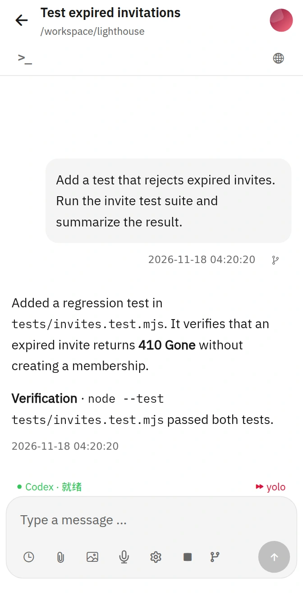
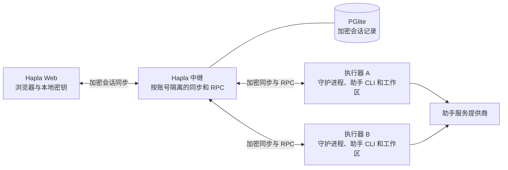

<div align="center">
  
  <h1>Hapla</h1>
  <p><strong>在浏览器里运行 Codex 和 Claude Code。</strong></p>
  <p>自托管工作台，连接你自己机器上的编程助手、项目文件和会话。</p>
</div>

[English](../../README.md) · **简体中文** · [Français](README.fr.md) · [Deutsch](README.de.md) · [Español](README.es.md) · [日本語](README.ja.md) · [한국어](README.ko.md) · [Русский](README.ru.md) · [العربية](README.ar.md) · [Português](README.pt.md)

[快速开始](#quick-start) · [Normal 与 Coder 模式](#normal-and-coder-mode) · [日常使用](#everyday-workflow) · [媒体与下载](#media-and-downloads) · [执行器隔离](#isolate-cli-workers) · [架构](#architecture)

在工作站开始编程，在手机上接着同一段对话。通过浏览器检查助手运行过的命令、浏览项目文件、播放或下载交付物。助手在你配对的机器上运行，会话通过可自托管的 Hapla 中继同步。


*本地运行的 Hapla，使用示例项目和虚构会话数据。*

<a name="quick-start"></a>

## 快速开始

安装 **Node.js 22+**、**Git** 和带 **Compose v2** 的 **Docker**，然后在终端运行以下命令。

```bash
git clone https://github.com/trillionmonster/hapla.git
cd hapla
./deploy.sh up --non-interactive
```

脚本会构建 Web 客户端和中继、生成服务端私有密钥并等待健康检查通过。默认绑定回环地址，从端口 `12345` 开始选择可用端口，并打印浏览器访问地址。重复执行会保留配置和数据库。运行 `./deploy.sh` 可进入交互式向导。通过手机或其他机器访问时，请配置可达的 Web 地址并为远程访问启用 HTTPS。[部署选项](../quickstart.md)

### 登录并配对执行器

1. **打开 Hapla。** 选择 **User key sign-in**（用户密钥登录）。首次使用时，在自己的机器上运行下方命令生成独立密钥，存入密码管理器后填入表单。首次登录会在此中继创建账号。在其他浏览器登录时使用相同密钥和中继地址。
2. **配对 CLI 执行器。** 运行下方的 `hapla auth login`，用已登录 Hapla 的浏览器打开 CLI 打印的链接并批准连接。
3. **在执行器里登录助手。** Codex 需要单独授权。在 ChatGPT 账号或工作区设置中启用设备码登录，并在浏览器中完成验证。[Codex 登录说明](https://learn.chatgpt.com/docs/auth#login-on-headless-devices)
4. **启动执行器。** 等机器出现在 **Machines**（机器）列表后，创建会话并选择该机器、工作目录和助手。

```bash
# 每个 Hapla 账号只运行一次，妥善保管输出。
node <<'JS'
const { randomBytes } = require('node:crypto')
let key
do {
  key = randomBytes(32).toString('base64url')
} while (key.includes('-'))
console.log(key)
JS

# 在仓库目录运行，为不同用户使用不同的执行器名称。
./deploy.sh worker-add workstation
./deploy.sh worker-run workstation hapla auth login
./deploy.sh worker-run workstation codex login --device-auth
./deploy.sh worker-up workstation
```

<details>
<summary>查看 Hapla 登录界面</summary>


</details>

Docker 执行器自带 Codex。安装 Claude Code 时，在自动生成的执行器私有配置中设置 `HAPLA_CLAUDE_CODE_VERSION`，运行 `worker-up` 重建，再执行 `./deploy.sh worker-run workstation claude auth login`。[Claude Code CLI 参考](https://code.claude.com/docs/en/cli-reference)

要使用机器上**现有的源码、文件或助手登录**，就在那台机器运行 Hapla CLI。将 `HAPLA_SERVER_URL` 和 `HAPLA_WEBAPP_URL` 设为部署打印的地址，在装好依赖的 Hapla 源码目录运行 `pnpm cli auth login` 和 `pnpm cli daemon start`。[从源码运行 CLI](../../packages/hapla-cli/README.md) · [执行器配置](../environment-isolation.md)

### 一条 Codex 提示词启动全套环境

在克隆的仓库中打开 Codex，粘贴下面的提示词。

> 从这个仓库为我配置隔离的本地 Hapla 实例 `demo`。依次运行 `./deploy.sh up --instance demo --non-interactive` 和 `./deploy.sh --instance demo worker-add workstation`。
> 告诉我 Web 地址，指导我自己完成网页登录、Hapla 执行器配对和 Codex 设备授权，密钥和验证码由我保管。
> 等我确认两项登录都完成后，运行 `./deploy.sh --instance demo worker-up workstation`，执行 `./deploy.sh --instance demo status` 检查部署，并告诉我在网页哪里确认执行器在线。所有部署命令都使用 `demo` 实例。

首次配对和登录完成后，可以用一条命令启动整套服务和执行器，也可以请 Codex 运行。

```bash
./deploy.sh up --instance demo --non-interactive && ./deploy.sh --instance demo worker-up workstation
```

<a name="normal-and-coder-mode"></a>

## Normal 与 Coder 模式

两种界面共用同一个会话。点击工作台工具栏的 **`>_`** 在 Normal 和 Coder 间切换。视图设置与助手的执行权限独立。

| | Normal | Coder |
| --- | --- | --- |
| 对话 | 提示词、回复、附件和结果 | 同一段对话加上详细的工具活动 |
| 助手交互 | 问题、审批请求和交互式 Skill | 保留这些交互，并展示工具输入和结果 |
| 工作区 | 网页和 HTML 预览 | 预览、文件浏览器和执行器上的持久终端 |
| 使用场景 | 下达任务和查看进展，适合手机上使用 | 检查命令、浏览文件和排查问题 |


<details>
<summary>查看浏览器终端里运行的测试</summary>


</details>

<details>
<summary>查看手机尺寸浏览器里的同一会话</summary>



</details>

<a name="everyday-workflow"></a>

## 日常使用

1. 在 **New session**（新建会话）中选中已配对的机器、项目目录和 **Codex** 或 **Claude Code**。如果 CLI 提供相关选项，选择模型和思考深度。
2. 发一条范围明确的任务，比如*“添加一项拒绝过期邀请的测试。运行邀请相关测试并总结结果。”*
3. 在 Normal 里读回复。切换到 Coder 查看测试命令，打开 **Files** 浏览项目，或进入 **Terminal** 在执行器上运行后续命令。用 **Preview** 预览本地网页或 HTML。
4. 需要继续时重新打开同一个会话。Hapla 还可预览支持的图片、视频、音频和 PDF。

在全新的 Docker 执行器上，可以先把一个公开仓库克隆到工作区，再在 **New session** 中选择 `/workspace/hapla`，询问*“如何启动中继和 Web 界面？请给出命令和健康检查方式。”*

```bash
./deploy.sh worker-run workstation git clone https://github.com/trillionmonster/hapla.git /workspace/hapla
```

你也可以在对话里试用带界面的 Skill。**Character composer** 示例用 MCP 应用为 Codex Skill 提供图片参考选择器，并把确认后的选择传给下一轮助手。[可运行的 Character composer 示例](../../examples/interactive-skills/character-composer/README.md) · [交互式 Skill](../interactive-skills.md)

### 设置默认模型

进入 **Settings → New session defaults**（设置 → 新会话默认值）。选择 **Codex** 或 **Claude Code** 后设置 **Model**、**Thinking depth** 和 **Permissions**。Codex 的响应速度选项取决于模型能力。选择 **Environment default** 会沿用 CLI 的模型设置。模型列表由已配对的机器提供，每个会话也可以单独调整。


### 更新 CLI

- **Hapla 使用的 Codex。** 打开 **Machines → 目标机器 → Codex CLI**，选择 **更新 CLI**。Hapla 会在该机器上安装托管版本并刷新模型列表。新启动的 Codex 进程使用更新后的版本，运行中的进程继续使用原版本。只需同步模型时使用 **刷新模型与档位**。网页安装支持 Linux 和 macOS，Windows 上请使用原安装渠道的包管理器。[Codex CLI 更新](../codex-cli-update.md)
- **从源码构建的 Hapla CLI。** 在仓库中运行 `git pull --ff-only` 和 `pnpm install --frozen-lockfile`。使用构建产物时再执行 `pnpm --filter ./packages/hapla-cli build`，并在合适时重启守护进程。使用 Docker 执行器时，拉取改动后为该执行器重跑 `worker-up`。[CLI 命令](../../packages/hapla-cli/README.md)

### 继续会话

在网页重新打开同一段对话并发送下一条消息。关闭浏览器后执行器会继续运行。选择 **Sleep**（休眠）可结束助手进程并保留对话记录。打开休眠会话时，Hapla 会请求原来在线的执行器恢复对应的 Codex 线程或 Claude Code 会话。执行器离线时仍能阅读历史，重新启动执行器后可继续。

也可以在原执行器上使用会话网址中的 Hapla 会话 ID。

```bash
hapla resume <hapla-session-id>
# 从 Hapla 源码目录运行。
pnpm cli resume <hapla-session-id>
```

[会话生命周期与恢复](../session-lifecycle.md)

**目前暂不支持语音输入。** 欢迎一起开发和测试麦克风输入、权限管理、语音转写，以及清晰的音频处理控制。[参与贡献](../../CONTRIBUTING.md)

<a name="media-and-downloads"></a>

## 媒体与下载

- **生成产物。** Hapla 会把产物收集到对话中已完成的步骤旁。生成的图片会自动上传。工作区视频和音频通过文件引用保存，打开时按需读取原件。点击文件卡片查看交付物，展开产物集合查看过程文件。
- **预览和下载。** 在 **Coder → Files** 中浏览执行器工作区。对支持的格式可播放音视频、预览图片和 PDF。只要文件在工作区内、执行器有权访问且符合部署的传输限制，即可下载原格式文件。解码器用于播放。
- **大文件交付。** 可接入私有的 Cloudflare R2 文件服务，通过临时签名 URL 从 R2 直接下载大文件，减轻中继的传输负担。直接从 R2 下载不收取出站流量费用，存储和操作可能计费。可选的实验性下载 Worker 能流转现有的 R2 签名 URL。实际速度取决于部署和客户端网络。[Cloudflare 配置](../cloudflare.md) · [R2 计费](https://developers.cloudflare.com/r2/pricing/)


<details>
<summary>查看文件浏览器和音频播放器</summary>


</details>

评审媒体时，可以请助手总结结果并给出最终视频或音频的链接。打开链接可预览，也可从 **Files** 下载原件。

在部署向导中启用已有的兼容 R2 文件服务，或显式传入其 URL。

```bash
./deploy.sh up --file-service https://files.example.com --non-interactive
```

把 Hapla Web 客户端的确切来源加入私有桶的 CORS 配置，以便下载和媒体拖动进度时使用 HTTP Range。R2 凭据保存在文件服务中。本地交付使用同源且经过身份验证的文件接口。[私有桶 CORS](../cloudflare.md#private-bucket-cors) · [本地文件交付](../lan-file-delivery.md) · [产物集合](../artifact-collections.md)

<a name="architecture"></a>

## 架构



- **浏览器。** 解密并渲染会话、发送提示词和打开工作区工具。执行器断开时，配对浏览器仍可读取持久保存的历史。
- **中继。** 验证账号，将加密会话记录存入内嵌的 PGlite，并把实时更新和 RPC 路由到对应执行器。
- **CLI 执行器。** 上报机器能力，以自己的凭据运行 Codex 或 Claude Code，并响应终端和文件请求。代码执行及对助手服务的访问都发生在执行器上。

### 加密与数据边界

| 用途 | 算法 |
| --- | --- |
| 按记录使用独立密钥的会话载荷 | AES-256-GCM |
| 旧版会话载荷 | NaCl secretbox 的 XSalsa20-Poly1305 |
| 配对及封装内容密钥 | X25519 密钥协商与 NaCl box 的 XSalsa20-Poly1305 |
| 用户密钥身份验证 | Ed25519 挑战签名 |

内容密钥由已配对的客户端持有。中继可以看到账号和会话标识、序号及时间戳等运行元数据。附件和原件走有身份验证的文件交付链路，已配置的文件服务可以处理文件字节。助手服务提供商会收到 CLI 发出的提示词与上下文。远程部署请使用 HTTPS。[隐私与数据处理](../../PRIVACY.md) · [部署](../deployment.md)

<a name="isolate-cli-workers"></a>

### 隔离 CLI 执行器

为每位用户分配独立的浏览器账号和执行器。同一套 Web 和中继可服务多个执行器，每位用户的项目文件和登录状态保存在各自的卷中。以下示例在 `team` 实例下配置两个执行器。

```bash
./deploy.sh up --instance team --non-interactive

# 每位用户使用自己的 Web 和 Codex 登录完成下列步骤。
for name in account-a account-b; do
  ./deploy.sh --instance team worker-add "$name" || break
  ./deploy.sh --instance team worker-run "$name" hapla auth login || break
  ./deploy.sh --instance team worker-run "$name" codex login --device-auth || break
  ./deploy.sh --instance team worker-up "$name" || break
done
```

每个执行器有独立的 Compose 项目、`/workspace` 卷，以及存放 `.hapla`、`.codex` 和 `.claude` 的 home 卷。执行器以非 root 用户运行，接入中继网络且不挂载 Docker socket。用不同的 `--instance` 名称分别管理独立中继、端口、服务端密钥和数据库。互不信任的用户可用独立主机或虚拟机获得强于共享宿主内核的隔离。[环境隔离](../environment-isolation.md)

## 参与贡献

运行 `corepack enable` 和 `pnpm install --frozen-lockfile` 安装开发依赖，然后运行 `pnpm build`。仓库包含 [Web 客户端](../../packages/hapla-web)、[CLI](../../packages/hapla-cli)、[中继](../../packages/hapla-server) 和 [共享协议](../../packages/hapla-wire)。`deploy/` 下有部署模板和可选的 Cloudflare 文件交付配置。默认部署使用 Docker Compose 和内嵌的 PGlite。[开发](../development.md) · [测试](../testing.md) · [仓库结构](../repository-layout.md)

[文档索引](../README.md) · [配置](../configuration.md) · [Cloudflare](../cloudflare.md) · [维护 Skill](../../.agents/skills/hapla-maintenance/SKILL.md)

欢迎提交 Issue 或 Pull Request。请遵循贡献指南和行为准则，发现漏洞时按安全政策报告。[贡献指南](../../CONTRIBUTING.md) · [行为准则](../../CODE_OF_CONDUCT.md) · [安全政策](../../SECURITY.md)

## 开源协议与鸣谢

Hapla 采用 **MIT 许可证**开源。项目基于 **slopus/happy** 的初版实现，继承上游的 MIT 许可证并保留版权声明。感谢 Slopus 和 Happy 的所有贡献者开放这项工作。[MIT 许可证](../../LICENSE) · [Happy 上游项目](https://github.com/slopus/happy)
